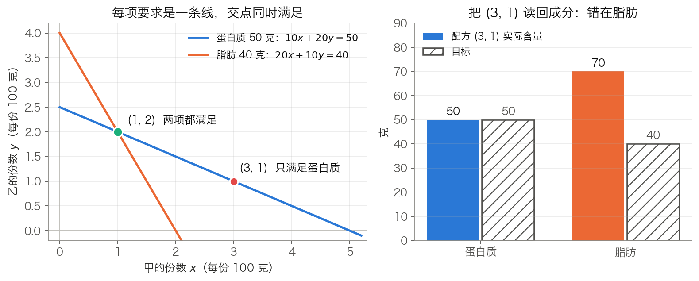

## 一份配方，要同时满足两件事

甲、乙两种原料的成分如下。每份是 100 克，数字为教学假设：

| 每份原料 | 蛋白质 | 脂肪 |
|---|---|---|
| 甲 | 10 克 | 20 克 |
| 乙 | 20 克 | 10 克 |

我们要得到蛋白质 50 克、脂肪 40 克。未知的是两种原料各放几份，记为 \(x,y\)。例如 \((1,2)\) 是甲 100 克、乙 200 克，不是两项成分的克数。

两项要求一起看，可能让人想直接猜一份配方。我们先把问题拆小：**暂时只管蛋白质，哪些用量可以？**

## 先满足一个要求

甲贡献 \(10x\) 克蛋白质，乙贡献 \(20y\) 克，所以要求

\[
10x+20y=50.
\]

如果甲不放，乙取 2.5 份；甲放 1 份，乙取 2 份；甲放 3 份，乙取 1 份。这三份都对，但显然不止这三份：甲还可以放 1.5 份，乙取 1.75 份。

继续列下去，会得到越来越长的清单。真正的问题不是再找一份，而是怎样把所有允许的用量说清楚。

选定 \(x\) 后，剩下的蛋白质必须由乙补足，因此

\[
y=\frac{50-10x}{20}=2.5-0.5x.
\]

这条关系比清单更有用：不论你选哪个 \(x\)，它都告诉你 \(y\) 必须是多少。所有满足这一要求的数对组成它的**解集**：

\[
S_1=\{(x,y)\in\mathbb R^2:y=2.5-0.5x\}.
\]

这行读作：“所有满足 \(y=2.5-0.5x\) 的实数对 \((x,y)\) 组成的集合。”花括号表示集合，\(\mathbb R^2\) 表示全部实数对，冒号后面写条件。

实际原料不能放负量，所以配方还要满足 \(x,y\ge0\)，留下 \(0\le x\le5\) 的部分。先记住这个区别：方程的实数解集是一件事，其中哪些实际可用是另一件事。

## 再把脂肪要求加回来

刚才 \((1,2)\) 和 \((3,1)\) 都满足蛋白质要求，它们的脂肪也相同吗？

前者有 \(20\cdot1+10\cdot2=40\) 克，后者有 \(20\cdot3+10\cdot1=70\) 克。所以第二项要求不是让我们重新从零猜，而是从第一批候选里再筛一遍。

脂肪条件为

\[
20x+10y=40.
\]

它也有自己的解集 \(S_2\)。最终用量必须属于两者，因而是交集 \(S_1\cap S_2\)。这就是“同时解两条方程”的意思。

左图中的点是用量：横轴甲、纵轴乙，每单位 100 克。两条线各自是一项要求；交点才满足两项。右图把被排除的 \((3,1)\) 读回成分，显示它错在脂肪，而不是蛋白质。

## 找到一份以后，怎么知道没有别的？

\((1,2)\) 已经通过两项核对。但“找到一个”还没有回答“是否只有一个”。我们需要让方程本身把选择确定下来。

第二条的 \(x\) 系数是第一条的两倍。因此把第一条乘 2，再从第二条减去，可以消掉 \(x\)：

\[
(20x+10y)-2(10x+20y)=40-100,
\qquad -30y=-60.
\]

于是 \(y=2\)。保留的第一条随后给出 \(10x+40=50\)，所以 \(x=1\)。两个变量都被确定，没有另一个选择。

为什么这次相减不会遗漏共同解？满足原两条的数对一定满足相减后的式子；反过来，满足第一条与新第二条的数对，把第一条的两倍加回去，就恢复原第二条。**我们保留了一条，再替换另一条，而不是只留下两条的差。**

所以共同解恰好是 \(\{(1,2)\}\)，并且非负，实际可用。

## 给这种约束一个名字

刚才两条要求都有同一种结构：已知系数乘未知量，再相加，等于给定目标。形如

\[
a_1x_1+\cdots+a_nx_n=b
\]

的关系叫**线性方程**。未知量以一次项出现，不互相相乘。几条方程共同约束同一组未知量，就组成线性方程组。

没有原料名称时，推理仍成立。例如 \(x+y=5,2x-y=1\)，共同解为 \((2,3)\)：两条各允许一批数对，我们找的是交集，不是分别给两条选择不同用量。

## 再试一份不同目标

保持成分表不变，把目标改为蛋白质 40 克、脂肪 50 克。先写方程，再按同样办法消元。

> [!DETAILS] 核对
> 第二条减第一条的两倍，得到 \(-30y=-30\)，所以 \(y=1,x=2\)。代回分别得到 40 和 50。目标变了，方法没有变。

[配料实验](https://colab.research.google.com/github/xiaoheng008/linear-algebra-evolution/blob/main/experiments/application_examples.ipynb)可以让你沿蛋白质条件移动，观察脂肪何时也合适；[方程组实验](https://colab.research.google.com/github/xiaoheng008/linear-algebra-evolution/blob/main/experiments/01_equations.ipynb)把同一件事画成直线。

这次第二项要求恰好确定了剩下的选择。下一章看看：多一条记录，是否一定能做到这一点？
