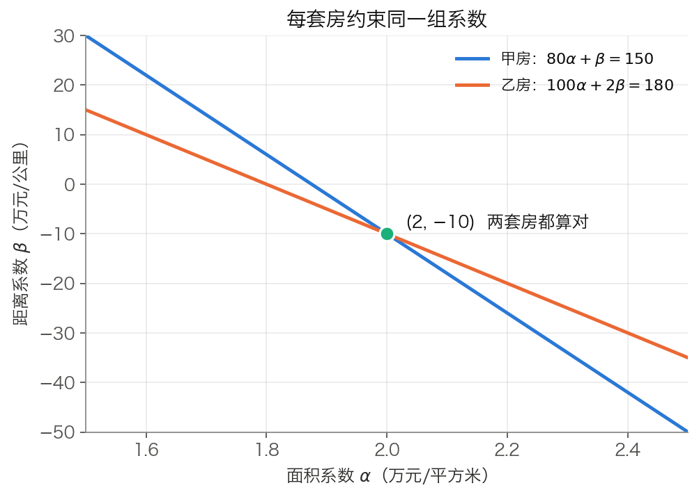

## 消元时，有哪些东西一直在重写？

配料条件仍是

\[
10x+20y=50,\qquad 20x+10y=40.
\]

每次操作，我们都按同样顺序写 \(x,y\)，真正变化的是它们前面的系数与右端。若有十种原料、二十项要求，反复写变量名并不会提供新信息，反而让我们难以对齐每个数。

能不能把系数先排好，变量另放一处？关键是排列之后还要能读回原来的每一条要求。

## 每项要求一行，每个用量一列

第一条计算蛋白质，第二条计算脂肪；两条都按甲、乙的顺序取系数：

\[
A=\begin{bmatrix}10&20\\20&10\end{bmatrix}.
\]

这种矩形数表叫**矩阵**。它的第一列是甲每份贡献，第二列是乙每份贡献；第一行是蛋白质，第二行是脂肪。与原来的成分表相比，我们换了排列方向，没有换数据。

再把用量与目标分别写成一列：

\[
\mathbf x=\begin{bmatrix}x\\y\end{bmatrix},\qquad
\mathbf b=\begin{bmatrix}50\\40\end{bmatrix}.
\]

粗体 \(\mathbf x\) 收集两项用量，与单个 \(x\) 区别开。我们暂时把它看成按固定顺序放好的记录，下一章再专门研究这样的记录怎样整体运算。

## 新写法怎样接回旧方程？

让矩阵每行分别乘对应的用量，再相加：

\[
A\mathbf x=\begin{bmatrix}10x+20y\\20x+10y\end{bmatrix}.
\]

第一项仍是蛋白质总克数，第二项仍是脂肪总克数。因此两项要求合在一起写成

\[
A\mathbf x=\mathbf b.
\]

这就是矩阵乘向量的按行计算。规则不是为了矩阵另创一套游戏，而是把我们已经在算的两条方程收在一起。

把用量竖排为 \(\mathbf x=\begin{bmatrix}1\\2\end{bmatrix}\) 核对，会得到 \((50,40)\)。矩阵的系数按克/份理解，用量按份理解，相乘后是克。

## 同一张表，可以问两个方向的问题

已知用量 \((2,1)\)，我们算得成分 \((40,50)\)。这次没有解方程，只是在做正向计算。

若只知道成分 \((40,50)\)，要找用量，就变成求满足 \(A\mathbf x=\mathbf b\) 的 \(\mathbf x\)。前两章做的是后一个方向。

因此看到 \(A\mathbf x=\mathbf b\)，不能光认符号，还要认清哪一边已知、哪一边待求。矩阵 \(A\) 可以相同，问题却不同。

## 多一些要求时，尺寸怎么决定？

假如有 \(n\) 种用量、\(m\) 项要求，每行需要 \(n\) 个系数，合计 \(m\) 行，所以 \(A\) 是 \(m\times n\)；输入列有 \(n\) 项，输出和目标各有 \(m\) 项。

第 \(i\) 项并没有发生神秘变化，还是

\[
a_{i1}x_1+\cdots+a_{in}x_n=b_i.
\]

这里 \(a_{ij}\) 表示第 \(i\) 行、第 \(j\) 列的系数：下标先写行，再写列。比如配料表的 \(a_{12}=20\)，是第一行（蛋白质）、第二列（乙）的那个数。

矩阵只是保证我们在很多行里使用同一个变量顺序。消元也仍是上一章的操作，只是可以整行处理数字。

回到配料，把右端也放在竖线后面，一起记成一张表：

\[
\left[\begin{array}{cc|c}10&20&50\\20&10&40\end{array}\right]
\longrightarrow
\left[\begin{array}{cc|c}10&20&50\\0&-30&-60\end{array}\right].
\]

箭头这一步就是第二章的“第二条减第一条的两倍”，只是不再写 \(x,y\)。读回第二行，便是 \(-30y=-60\)。变量名没有消失，它们记在列的位置里：第一列一直是 \(x\) 的系数，第二列一直是 \(y\) 的系数。

## 换一个场景，谁才是未知量？

现在试试房价。假设价格（万元）等于面积（平方米）乘 \(\alpha\)，加到学校的距离（公里）乘 \(\beta\)，暂不加固定起价。下面是教学数据：

| 房屋 | 面积 | 距离 | 价格 |
|---|---|---|---|
| 甲 | 80 | 1 | 150 |
| 乙 | 100 | 2 | 180 |

未知的不是面积或距离，而是同一组系数 \(\alpha,\beta\)。两套房各给一条约束：

\[
80\alpha+\beta=150,\qquad100\alpha+2\beta=180.
\]

第一式乘 2 再减第二式，得到 \(60\alpha=120\)，所以 \(\alpha=2,\beta=-10\)。现在排成矩阵：

\[
\begin{bmatrix}80&1\\100&2\end{bmatrix}
\begin{bmatrix}\alpha\\\beta\end{bmatrix}
=\begin{bmatrix}150\\180\end{bmatrix}.
\]

每行是一套房，未知的输入却是两个系数，不是房屋数据。记号与配料相同，量的意义变了。

图中的点是系数组合 \((\alpha,\beta)\)。系数确定后，对面积 90、距离 0.5 的丙房计算

\[
\begin{bmatrix}90&0.5\end{bmatrix}\begin{bmatrix}2\\-10\end{bmatrix}=175.
\]

这是模型预测 175 万元，不是已知成交价。第二十章会拿新观测检查这套共同解释是否仍能精确成立。

## 把表真正读懂

[配料实验](https://colab.research.google.com/github/xiaoheng008/linear-algebra-evolution/blob/main/experiments/application_examples.ipynb)与[房价实验](https://colab.research.google.com/github/xiaoheng008/linear-algebra-evolution/blob/main/experiments/03_matrix_system.ipynb)分别检查这两种排列。读每张表时，先说清一行、一列和待求输入分别代表什么，再运算。

试着自己给三项要求、两种原料排一张系数表，并逐行还原方程。如果能还原，新记号就没有掩盖旧问题。下一章我们会把输入和输出的整列数当作对象，相加、缩放，而不总是拆开处理。
