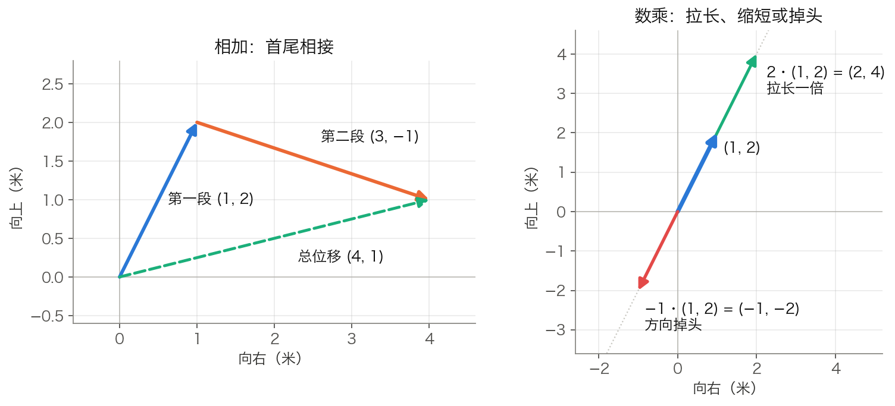
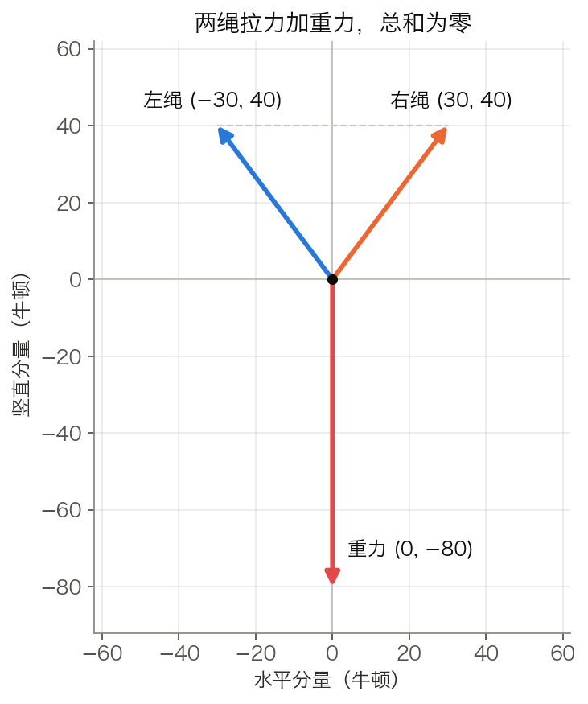

## 两次计算，其实可以一起做

每份甲的成分是蛋白质 10 克、脂肪 20 克，乙是 20 克、10 克。取甲一份、乙两份时，我们算

\[
10+2\cdot20=50,\qquad20+2\cdot10=40.
\]

两条算式并排看，做的是相同的操作：把乙的两项都放大两倍，再分别与甲的对应成分相加。与其每次重新拆开，不如把一份原料的完整贡献一起记住：

\[
(10,20)+2(20,10)=(50,40).
\]

乘 2 不是只改变一种成分，而是让一整份贡献变成两份；相加也不是随便挑数，而是蛋白质加蛋白质、脂肪加脂肪。顺序或单位不一致时，这样相加就没有原来的意义。

## 这个规则也能记录位移

从原点先向右 1 米、向上 2 米，再向右 3 米、向下 1 米。总位移为

\[
(1,2)+(3,-1)=(4,1)\text{ 米}.
\]

虽然成分换成了方向，规则仍是对应项相加。这里把向下记为负，负号的含义由问题决定。

位移可以画成箭头，于是加法和数乘都有了图像。先走第一段，再从**第一段的终点**出发走第二段，最后从起点指向终点的箭头就是总位移。这叫**首尾相接**：两段向右的量 1 和 3 合成 4，向上 2 和向下 1 合成向上 1，图上看到的正是逐项相加。

两次重复同一位移，是 \(2(1,2)=(2,4)\)：方向不变，箭头拉长一倍。乘 \(0.5\) 则缩短一半；乘 \(-1\) 得 \((-1,-2)\)，长度不变，方向掉头。所以数乘只改变箭头的长短和朝向，不会把它转到别的斜度上。

## 给这种整体运算一个名字

按固定顺序记录的 \(n\) 个实数，写成一列，就是 \(\mathbb R^n\) 中的**向量**：

\[
\mathbf x=\begin{bmatrix}x_1\\x_2\\\vdots\\x_n\end{bmatrix}.
\]

竖排很占地方，所以行文里常横着写成 \((x_1,\ldots,x_n)\)；有时在右上角加个 \(T\)，写成 \((x_1,\ldots,x_n)^T\)，提醒读者它其实是一列。这个记号章末再细说。

本书现在研究的是实数坐标向量。它不一定代表空间中的位移，也可以代表用量、成分、库存或价格。共同点是有明确的坐标顺序，并按以下规则运算：

\[
\begin{bmatrix}u_1\\u_2\end{bmatrix}+\begin{bmatrix}v_1\\v_2\end{bmatrix}
=\begin{bmatrix}u_1+v_1\\u_2+v_2\end{bmatrix},\qquad
c\begin{bmatrix}u_1\\u_2\end{bmatrix}=\begin{bmatrix}cu_1\\cu_2\end{bmatrix}.
\]

这些定义只是把刚才做过的整份相加、整份缩放写清楚。即使向量不是位移，也可以借箭头图来想象：相加是首尾相接，数乘是拉长、缩短或掉头。

## 两根绳子的贡献怎样相加？

再换一个需要方向的例子：用两根绳吊住一个重物。力既有大小又有方向，但可以像位移那样，拆成水平、竖直两部分分别记录。

重物受重力，向下 80 牛顿。左绳斜着向左上拉。设它的方向像一个 3-4-5 直角三角形的斜边：沿绳每走 5 份，就往左 3 份、往上 4 份。所以左绳每用 1 牛顿拉力，水平方向分到 \(3/5=0.6\) 牛顿（向左，记为负），竖直方向分到 \(4/5=0.8\) 牛顿。右绳对称，向右上拉。绳子拉物体的力叫**张力**；每 1 牛顿张力的两部分是

\[
\mathbf u=(-0.6,0.8)^T,\qquad\mathbf v=(0.6,0.8)^T.
\]

若各拉 50 牛顿，左绳贡献 \((-30,40)\)，右绳贡献 \((30,40)\)。整份力相加，得到 \((0,80)\)，再加重力 \((0,-80)\)，总和为零。

图里箭头表示力，不表示绳子的实际长度。

可 50 牛顿是怎么知道的？设左、右张力为 \(T_L,T_R\)（下标 L、R 表示左、右），两绳的力加上重力为零，水平、竖直两项分别是

\[
-0.6T_L+0.6T_R=0,\qquad0.8T_L+0.8T_R=80.
\]

第一条说明 \(T_L=T_R\)，两绳张力相等。代入第二条，\(1.6T_L=80\)，所以各 50 牛顿。向量整体运算没有代替方程，而是把每根绳同时贡献两个方向这件事组织得更清楚。

同样的规则也适用于没有方向的记录。库存 \((12,8)\) 箱加上送来的 \((3,2)\) 箱，得到 \((15,10)\) 箱。只要两份记录的坐标顺序和单位一致，就可以逐项相加、整体缩放。

## 记号说明：横着写和竖着写

正文里常把向量横着写成 \((10,20)\)，只是为了节省版面。真正参与矩阵乘法时，我们约定向量竖着排成一列。要明确写出行列，可以写

\[
\mathbf u=\begin{bmatrix}10\\20\end{bmatrix},\qquad
\mathbf u^T=\begin{bmatrix}10&20\end{bmatrix}.
\]

上标 \(T\) 表示**转置**，把行列交换，不是取幂；转置两次就回到原来的样子。所以 \((10,20)^T\) 就是竖排的那一列，后面的章节常用这种写法。

为什么要分清？上一章算 \(A\mathbf x\) 时，是拿矩阵的每一行去对应乘竖排 \(\mathbf x\) 的各项。把 \(\mathbf x\) 换成横排的一行，这种逐项对应就对不上了。

你可以在[位移实验](https://colab.research.google.com/github/xiaoheng008/linear-algebra-evolution/blob/main/experiments/04_vectors.ipynb)画出先后两段位移，再核对总位移；在[绳索实验](https://colab.research.google.com/github/xiaoheng008/linear-algebra-evolution/blob/main/experiments/physics_forces.ipynb)把 10 牛顿从左绳移到右绳，看看水平和竖直合力哪项改变。

下一章回到成分矩阵。既然一列可以记录一整份贡献，我们能否不再逐行算，而是先合并每种原料的完整贡献？
