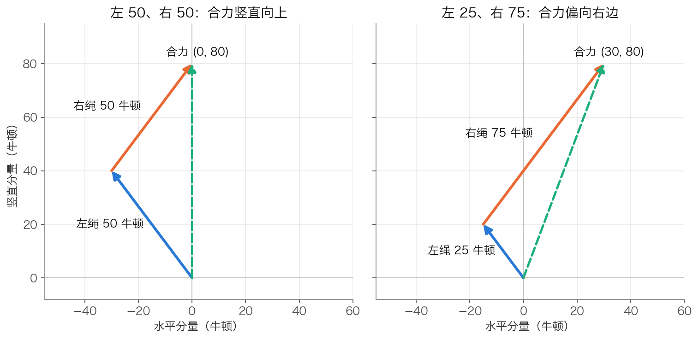

## 我们已经会按行算，再看一次每列

成分表为

\[
A=\begin{bmatrix}10&20\\20&10\end{bmatrix}.
\]

用量 \((1,2)^T\) 产生

\[
A\begin{bmatrix}1\\2\end{bmatrix}
=\begin{bmatrix}10\cdot1+20\cdot2\\20\cdot1+10\cdot2\end{bmatrix}
=\begin{bmatrix}50\\40\end{bmatrix}.
\]

按行算，分别回答蛋白质和脂肪有多少。不过我们取原料时，不是先取蛋白质，再取脂肪：一份甲带来两项，一份乙也带来两项。这个动作更适合按列读。

## 一列就是一整份贡献

甲、乙每份的完整成分正是两列：

\[
\mathbf a_1=\begin{bmatrix}10\\20\end{bmatrix},\qquad
\mathbf a_2=\begin{bmatrix}20\\10\end{bmatrix}.
\]

一份甲、两份乙，就是先把第二列放大两倍，再整列相加：

\[
\mathbf a_1+2\mathbf a_2
=\begin{bmatrix}10\\20\end{bmatrix}+\begin{bmatrix}40\\20\end{bmatrix}
=\begin{bmatrix}50\\40\end{bmatrix}.
\]

结果当然应该相同，因为我们没有改原料，只改变了合并顺序。按行是在算每项总量，按列是在合并每种原料的贡献。

若用量改成 \((2,1)^T\)，先想整份贡献会怎样换，再核对：得到 \(2\mathbf a_1+\mathbf a_2=(40,50)^T\)。这也说明输入的第一项究竟负责什么：它不是输出第一项，而是**第一列取多少倍**。

## 把这个读法写成任意用量

用量是 \(x,y\) 时，两项总成分可以重新分组为

\[
A\begin{bmatrix}x\\y\end{bmatrix}
=x\begin{bmatrix}10\\20\end{bmatrix}
+y\begin{bmatrix}20\\10\end{bmatrix}.
\]

若有更多列，道理也一样。只看第 \(i\) 个坐标，按行得到 \(\sum_jA_{ij}x_j\)；按列取 \(x_j\) 倍相加，第 \(i\) 项仍是这个和。每项都相同，所以

\[
A\mathbf x=\sum_{j=1}^n x_j\mathbf a_j.
\]

这条公式不是需要另外接受的乘法规则，而是原规则的重新分组。把若干向量分别乘一个数再相加，叫它们的**线性组合**。

## 已知用量，和找用量，是同一个关系的两面

给定 \(\mathbf x\)，\(A\mathbf x\) 算它能产生的结果。给定目标 \(\mathbf b\)，求 \(A\mathbf x=\mathbf b\)，就是找每列取几倍才能拼出目标。

第一章把它看成各行约束的交集；现在按列看，则是各份贡献的组合。两个视角在回答同一个问题，不是两套互不相干的理论。

这也留下一个新疑问：我们已经能拼出 \((50,40)\)，但是否每个目标都能这样拼？如果某个目标拼不出，是用量没选好，还是这些列本身不够？下一章要把这两种情况分清。

## 力的合成也能按列读

左、右绳方向是 \((-0.6,0.8)^T\)、\((0.6,0.8)^T\)。各 50 牛顿时：

\[
50\begin{bmatrix}-0.6\\0.8\end{bmatrix}
+50\begin{bmatrix}0.6\\0.8\end{bmatrix}
=\begin{bmatrix}0\\80\end{bmatrix}.
\]

矩阵把两个方向排成列，输入的两项就是两根绳的张力。这里系数表是无单位的方向分量，输入、输出都是牛顿；与配料的克/份不同，但重新分组的理由相同。

右图把两个力首尾相接，绿色箭头是绳索合力。仍须加上重力，才能得到总外力零。

数学上的线性组合允许任意实数系数，配料用量、绳索张力却须非负。我们会先研究所有实数组合的范围，再回到场景筛选可行方案；这样可以知道限制来自列的关系，还是来自实际用量。

## 不借背景也读得懂吗？

取 \(A=\begin{bmatrix}1&1\\2&-1\end{bmatrix}\)、输入 \((2,3)^T\)。不直接逐行算，先写成两列的组合。

> [!DETAILS] 核对
> \(2(1,2)^T+3(1,-1)^T=(5,1)^T\)。逐行也得到 \((2+3,4-3)^T\)。输入有两项，分别控制两列，而不是分别控制输出的两项。

[列组合实验](https://colab.research.google.com/github/xiaoheng008/linear-algebra-evolution/blob/main/experiments/05_column_combination.ipynb)让你分别改变两个输入；[配料实验](https://colab.research.google.com/github/xiaoheng008/linear-algebra-evolution/blob/main/experiments/application_examples.ipynb)和[绳索实验](https://colab.research.google.com/github/xiaoheng008/linear-algebra-evolution/blob/main/experiments/physics_forces.ipynb)把每列重新读回实际贡献。
