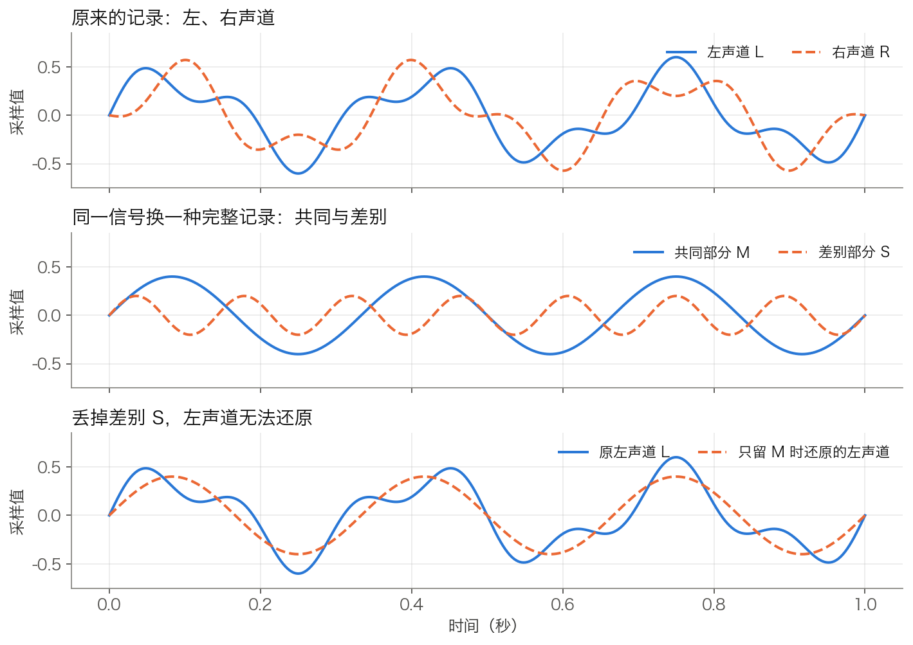

## 删掉多余的以后，怎么知道仍然够用？

上一章丙的贡献等于甲乙之和，因此先把丙从记录里删去。甲乙的成分列是

\[
\mathbf a=(10,20)^T,\qquad\mathbf b=(20,10)^T.
\]

能不能再省一个，只留下甲？对目标 \((50,40)^T\)，蛋白质要求甲取 5 份，脂肪却要求取 2 份。同一个用量无法满足两项。

只留甲，没有重复，却少了能力；甲乙丙都留，能力够，却多了记录。我们想要的是一种**既能描述全部目标，又不留下重复自由选择**的记录方式。

## 两个为何刚好够？

先允许任意实数用量。任意目标成分 \((P,F)^T\) 要求

\[
10r+20s=P,\qquad20r+10s=F.
\]

与前面同样消元，得到

\[
s=\frac{2P-F}{30},\qquad r=\frac{2F-P}{30}.
\]

所以每个实数目标都有表示。再检查表示是否唯一：若两套甲乙用量得到相同成分，相减就是输出为零的调整；上一章已算过只有零调整，因此两套用量必然一样。

这两项要求各负责一件事：能表示，保证记录存在；没有非零零组合，保证记录唯一。缺哪一项都不够。

## 这样的向量组，叫作基

一组向量若张成空间，并且线性无关，就叫空间的一组**基**。甲乙是 \(\mathbb R^2\) 的一组基；单甲无关但不张成平面；甲乙丙张成平面但相关。

确定基和它的顺序后，一个向量在这些基向量前面的组合系数叫它的**坐标**。目标 \((50,40)^T\) 在甲乙基下是 \((1,2)^T\)：甲取一份、乙取两份。这两个数不是目标的蛋白质、脂肪克数。

一般的唯一性也可以从刚才的差来证明。若

\[
\mathbf z=\sum_i r_i\mathbf v_i=\sum_i s_i\mathbf v_i,
\]

相减得 \(\sum_i(r_i-s_i)\mathbf v_i=0\)。基无关，所以每项 \(r_i-s_i=0\)。张成保证坐标存在，无关保证坐标唯一。

## 同一个目标，换一份记录

基不一定只有一种选择。丙满足 \(\mathbf c=\mathbf a+\mathbf b\)，因此 \(\mathbf a=\mathbf c-\mathbf b\)。原来任何表示都能改写：

\[
r\mathbf a+s\mathbf b=(s-r)\mathbf b+r\mathbf c.
\]

这说明乙丙也够用。它们是否重复？若 \(\alpha\mathbf b+\beta\mathbf c=0\)，代入丙的关系便是 \(\beta\mathbf a+(\alpha+\beta)\mathbf b=0\)。甲乙无关，得 \(\beta=\alpha=0\)。所以乙丙也构成基。

同一目标 \((50,40)^T\)，甲乙坐标为 \((1,2)^T\)，乙丙坐标为 \((1,1)^T\)。**目标没有改变，改变的是用哪些方向记录它。** 坐标必须带着基的顺序一起读。

不过数学表示与实际配方仍有区别。一份甲在乙丙下为 \((-1,1)^T\)，需要负量乙。两组基都表示整个实平面，不代表它们的非负配方范围相同。

## 换成最简单的坐标，关系更容易看

平面中的 \(\mathbf e_1=(1,0)^T,\mathbf e_2=(0,1)^T\) 可以表示任意 \((x,y)^T=x\mathbf e_1+y\mathbf e_2\)；零组合只能两系数都为零。它们叫**标准基**。

现在把方向换成 \(\mathbf p=(1,1)^T,\mathbf q=(1,-1)^T\)。为什么这次会想到两个？因为一个负责两项一起增加，另一个负责一项增加、另一项减少，正好可以分别控制和与差。

要表示 \((x,y)^T=M\mathbf p+S\mathbf q\)，按坐标读得

\[
M+S=x,\qquad M-S=y.
\]

于是 \(M=(x+y)/2,S=(x-y)/2\)，每个目标有且只有这一套系数，所以也是基。对 \((3,1)^T\)，新坐标为 \((2,1)^T\)。不要把它当成目标移到了平面上的另一个点。

## 双声道为什么会用这组基？

左右信号 \((L,R)^T\) 中，有些变化两边一起发生，有些变化只在两边的差别里。刚才的两个正好记录这两类贡献：

\[
(L,R)^T=M(1,1)^T+S(1,-1)^T,
\qquad M=\frac{L+R}{2},\quad S=\frac{L-R}{2}.
\]

采用这里除以 2 的中间/侧边刻度，\((3,1)\) 变成 \((2,1)\)，再用 \(L=M+S,R=M-S\) 就恢复原信号。

完整记录并没有丢失信息。若只保留 \(M=2\) 呢？\((3,1)\) 与 \((2,2)\) 都给出这个数，已分不清它们。换一种完整描述，与删除一项描述，是两件不同的事。

图的横轴是时间，纵轴是采样值。前两组是同一信号的不同完整记录，最后一组才展示丢掉差别后的损失。

## 试试这份坐标记录

在 \(\mathbf p,\mathbf q\) 基下，\((2,2)^T\) 和 \((2,-2)^T\) 各需要哪些系数？只留一个系数分别会损失什么？

> [!DETAILS] 核对
> 前者为 \(2\mathbf p\)，坐标 \((2,0)\)；后者为 \(2\mathbf q\)，坐标 \((0,2)\)。第一项记录共同信号，第二项记录左右差别；删掉任何一项，都不能恢复所有信号。

[基与坐标实验](https://colab.research.google.com/github/xiaoheng008/linear-algebra-evolution/blob/main/experiments/08_basis.ipynb)以及[配料实验](https://colab.research.google.com/github/xiaoheng008/linear-algebra-evolution/blob/main/experiments/ingredients_basis.ipynb)检查不同基的系数；[双声道实验](https://colab.research.google.com/github/xiaoheng008/linear-algebra-evolution/blob/main/experiments/application_examples.ipynb)检查整段信号的换基与恢复。

我们已找到几组平面基，方向各不相同，却都使用两个。这个数只是例子碰巧相同，还是空间本身决定了它？
