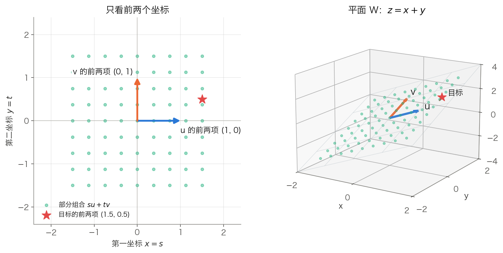

## 三个字段，真的需要三个独立的数吗？

报表按“线上、线下、总额”记录 \((120,80,200)\) 元。只存总额，不能恢复各渠道；但存前两项，第三项就可以相加得到。

所以记录写了三个坐标，却只需要两个可独立选择的数。我们想把这个区别说清：外面记录多少坐标，与集合里面需要多少个独立系数，不一定相同。

先允许任意实数 \(s,t\)，把记录集合写成

\[
W=\{(s,t,s+t)^T:s,t\in\mathbb R\}.
\]

这是三维坐标中经过原点的平面 \(z=x+y\)。

## 找一份够用又不重复的描述

前两项每增加一单位，整条记录分别增加

\[
\mathbf u=(1,0,1)^T,\qquad\mathbf v=(0,1,1)^T.
\]

所以 \((s,t,s+t)^T=s\mathbf u+t\mathbf v\)。每条记录都能写；组合为零时，前两个坐标又分别要求 \(s=t=0\)。两个构成 \(W\) 的一组基。

图中的三维点用三个坐标表示，但平面内一个点由两个系数决定。散点只是一部分，表示整个平面的理由是刚才的等式，而不是图画得够密。

## 换一组基，会不会需要更多系数？

上一章甲乙、乙丙都是平面的基，都有两个。报表平面也能换基，例如 \(\mathbf u,\mathbf d=\mathbf u+\mathbf v\)，因为 \(\mathbf v=\mathbf d-\mathbf u\)，原表示可以改写。还是两个。

若想只留一个，它的倍数只在一条线上，表示不了平面；若保留三个，它们似乎总有一个能由其余拼出来。这给出了猜想，但要把“基的个数”当成空间的性质，必须说明不是仅对这几组方向成立。

证明的想法可以从一次换基看出来：**放进一个新向量，就取出一个可以由新清单表示的旧向量，范围不变。**

## 先做两次替换，再看一般理由

从标准基 \(\mathbf e_1,\mathbf e_2\) 换成 \(\mathbf p=(1,1)^T,\mathbf q=(1,-1)^T\)。

先放入 \(\mathbf p=\mathbf e_1+\mathbf e_2\)，由于 \(\mathbf e_1=\mathbf p-\mathbf e_2\)，可以取出 \(\mathbf e_1\)，仍然够用。再把 \(\mathbf q\) 写成当前清单：\(\mathbf q=\mathbf p-2\mathbf e_2\)，所以 \(\mathbf e_2=(\mathbf p-\mathbf q)/2\)，可以取出 \(\mathbf e_2\)。

两次都没有增加位置，却把基换了。一般证明要检查的，是放入更多无关向量时，是否总能找到尚未取出的旧位置。

> [!DETAILS] 证明：无关向量不会比张成组更多
> 设 \(\mathbf v_1,\ldots,\mathbf v_m\) 张成空间，\(\mathbf u_1,\ldots,\mathbf u_r\) 是其中无关的向量。
>
> 把第一个新向量写成 \(\mathbf u_1=\sum_jc_j\mathbf v_j\)。它非零，所以某个 \(c_j\ne0\)。移项并除以 \(c_j\)，就能用 \(\mathbf u_1\) 和其他旧向量表示被取出的 \(\mathbf v_j\)，张成不变。
>
> 放入第 \(i\) 个时，它也能用当前清单表示。若只用前 \(i-1\) 个新向量，就与新向量组无关矛盾；所以必有尚未取出的旧向量系数非零，可以再替换一个。
>
> 旧清单只有 \(m\) 个位置。全部换完后，再加入的向量必由当前清单表示，不能继续无关。因此 \(r\le m\)。
>
> 两组基分别有 \(r,m\) 个，一组无关、另一组张成，得 \(r\le m\)；交换角色又得 \(m\le r\)。于是 \(r=m\)。

这个证明让我们可以放心给空间一个固定的数，而不依赖挑了什么方向。

## 这个数叫维数

能由有限个向量张成的空间叫有限维空间，本书遇到的都是这种。它的一组基所含的向量个数叫**维数**，记作 \(\dim V\)。有限张成组可以逐次删去可替代的向量，直到不再重复，得到基；上面的证明保证所有基都用相同个数。

报表平面 \(W\) 的维数是 2，虽然它的向量写成三个坐标。直线 \(\{(t,2t)^T\}\) 的维数是 1，虽然写成两个坐标。整个 \(\mathbb R^3\) 则有标准基三个，维数为 3。

只含零向量的空间，约定维数为 0。零向量本身不能当基向量，因为它一出现就造成相关。

这里的子空间含零，并对相加、任意实数数乘封闭。平移后不经过原点的直线，不是这类子空间；不能只凭“图形像一条线”就把它当作同一种对象。

## 多一个真正独立的量，才会增加维数

若第三项不再必须等于前两项之和，而可以有独立差额 \(h\)，记录变成 \((s,t,s+t+h)^T\)。加入 \(\mathbf w=(0,0,1)^T\) 后：

\[
s\mathbf u+t\mathbf v+h\mathbf w=(s,t,s+t+h)^T.
\]

前两项确定 \(s,t\)，第三项再确定 \(h\)；零组合只可能三项系数都为零。任意 \((x,y,z)^T\) 可取 \(s=x,t=y,h=z-x-y\)，所以现在是三维空间的基。

增加维数的是可以独立变化的量，而不只是多写一个字段。

## 为什么记录总质量会改变原料关系？

甲乙丙只记录两项成分时，丙等于甲乙之和。把每份 100 克总质量也记录下来，三列变成

\[
\widetilde{\mathbf a}=(10,20,100)^T,\quad
\widetilde{\mathbf b}=(20,10,100)^T,\quad
\widetilde{\mathbf c}=(30,30,100)^T.
\]

旧关系的差现在是 \((0,0,-100)^T\)，不再为零。还得检查有没有另一种关系：若 \(r\widetilde{\mathbf a}+s\widetilde{\mathbf b}+t\widetilde{\mathbf c}=0\)，前两项给出 \(r=s=-t\)，质量项 \(r+s+t=0\) 又迫使 \(t=0\)，三项全零。

任意目标 \((P,F,M)^T\) 的实数表示也可以求出。三条方程是

\[
10r+20s+30t=P,\qquad20r+10s+30t=F,\qquad100(r+s+t)=M.
\]

前两条相加得 \(30(r+s+2t)=P+F\)，第三条给 \(r+s+t=M/100\)，两者相减就分离出 \(t\)。前两条相减得 \(10(s-r)=P-F\)，再配合 \(r+s=M/100-t\) 求出 \(r,s\)：

\[
t=\frac{P+F}{30}-\frac M{100},\qquad
r=\frac M{100}+\frac{F-2P}{30},\qquad
s=\frac M{100}+\frac{P-2F}{30}.
\]

代回可核对，三列成为 \(\mathbb R^3\) 的基。原料没有换，记录的输出却换了。所以讨论维数前，要先说清描述的是哪个空间。

## 用改变条件来检查理解

[维数实验](https://colab.research.google.com/github/xiaoheng008/linear-algebra-evolution/blob/main/experiments/09_dimension.ipynb)让你删去一个、加上重复方向，或把目标移出 \(z=x+y\) 平面。可以先尝试一个 \(s,t\) 目标，再用表示式解释所有同类目标。

[配料与维数实验](https://colab.research.google.com/github/xiaoheng008/linear-algebra-evolution/blob/main/experiments/ingredients_basis.ipynb)比较加入总质量前后的列关系。

如果有十根绳都竖直，合力仍只有一个方向；两根独立斜绳的实数组合却能得到整个二维力空间。输入记录有几项，输出范围有几维，已经不再是同一个问题。接下来固定矩阵，看看它怎样作用于整个空间。
