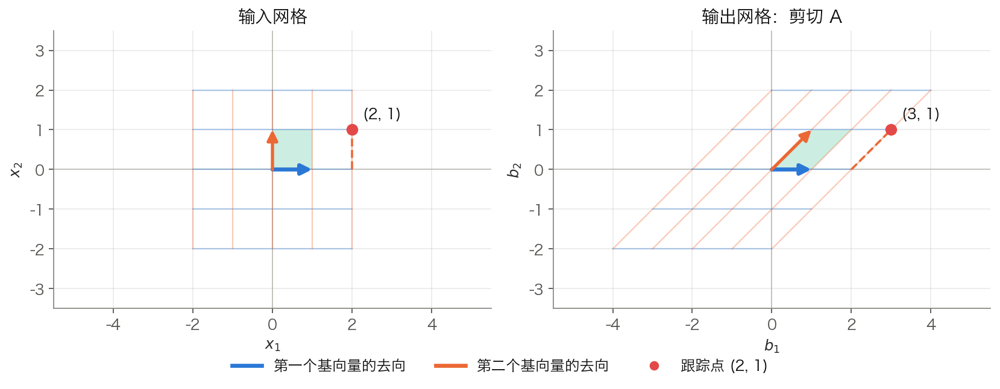
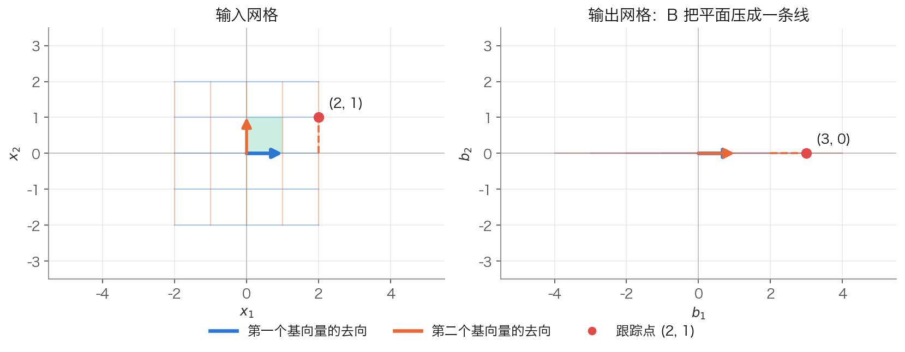

## 一个点算得出，整张网格怎么办？

固定矩阵

\[
A=\begin{bmatrix}1&1\\0&1\end{bmatrix}.
\]

输入 \((2,1)^T\)，按行算：第一项 \(1\cdot2+1\cdot1=3\)，第二项 \(0\cdot2+1\cdot1=1\)，输出 \((3,1)^T\)。同样，输入 \((-1,1)^T\) 得到 \((0,1)^T\)。逐点算没有困难，但如果想知道整个平面怎样变，点有无穷多个，不能靠长清单描述。

上一章的基提供了另一种起点：每个输入都由少量基向量组合出来。**如果知道这些基的输出，组合系数还能照用吗？**

## 只跟踪两个基向量，先试一个点

标准基是 \(\mathbf e_1=(1,0)^T,\mathbf e_2=(0,1)^T\)。分别代入，得到

\[
A\mathbf e_1=(1,0)^T,\qquad A\mathbf e_2=(1,1)^T.
\]

它们正好是矩阵的两列：乘第一个基向量只选出第一列，乘第二个基向量只选出第二列。

输入 \((2,1)^T=2\mathbf e_1+\mathbf e_2\)。先让两个基向量走到各自输出，再照原系数组合，得到 \(2(1,0)^T+(1,1)^T=(3,1)^T\)，与直接算相同。

为什么能对任意输入都这样做？第五章说过，矩阵乘一个组合，等于把各列按同样的系数组合。任意输入都能写成 \(s\mathbf e_1+t\mathbf e_2\)，所以

\[
A(s\mathbf e_1+t\mathbf e_2)
=sA\mathbf e_1+tA\mathbf e_2=(s+t,t)^T.
\]

不用逐点列清单，两个基向量的去向就确定了所有输入的去向。这不是因为基只有两个，而是这个计算保留了组合系数。

## 这条规则怎样改变网格？

输出的第二项仍是 \(t\)，第一项变成 \(s+t\)。同一水平线的点有相同 \(t\)，所以都横移同样的量：高度 1 向右移 1，高度 2 向右移 2，高度 −1 则向左移 1；横轴不动。

原水平线仍水平，原竖直线却倾斜。单位正方形顶点依次变成 \((0,0)\)、\((1,0)\)、\((2,1)\)、\((1,1)\)，形成平行四边形。这叫剪切。

蓝、橙箭头跟踪基，红点跟踪 \((2,1)\)，绿色区域跟踪正方形。这里是输入图与输出图，不是把一个坐标数组在两种基下重复记录。

## 哪种规则允许我们一直保留系数？

刚才的计算用了两件事：输入相加，输出也相加；输入乘一个数，输出也乘那个数。把本例代入可以直接核对

\[
A(\mathbf u+\mathbf v)=A\mathbf u+A\mathbf v,\qquad
A(c\mathbf u)=cA\mathbf u.
\]

对任意矩阵也成立。以输出的第一项为例：\(A(\mathbf u+\mathbf v)\) 的第一项是 \(a_{11}(u_1+v_1)+a_{12}(u_2+v_2)\)，按乘法分配律拆开，正好是 \(A\mathbf u\) 与 \(A\mathbf v\) 的第一项之和。数乘同理。

把输入送到输出的规则记为 \(T\)。若对任意输入和实数都满足

\[
T(\mathbf u+\mathbf v)=T(\mathbf u)+T(\mathbf v),\qquad
T(c\mathbf u)=cT(\mathbf u),
\]

就叫**线性变换**。我们发现的“照原系数合起来”正是它的核心作用。

取 \(c=0\) 得 \(T(0)=0\)：线性变换一定把原点留在原点。所以“给每个输出额外加 \((1,0)\)”这种平移不是线性变换，原点被移走了。

反过来，原点不动还不够。比如 \(T(s,t)=(s^2,t)\) 不动原点，但 \((1,0)+(1,0)\) 先相加再变换得 \((4,0)\)，分别变换再相加却得 \((2,0)\)。两种算法结果不同，所以它不线性。判断时要检查两条规则，不能只看原点或图形。

## 反过来，只给基的去向够吗？

假设某个线性变换把 \(\mathbf e_1\) 送到 \((2,1)^T\)，把 \(\mathbf e_2\) 送到 \((1,-1)^T\)。对 \((3,2)^T\)，无需再问一条新规则：输出就是 \(3(2,1)^T+2(1,-1)^T=(8,1)^T\)。

把两个标准基向量的输出排成列，就得到矩阵 \(\begin{bmatrix}2&1\\1&-1\end{bmatrix}\)。一般的 \(T:\mathbb R^n\to\mathbb R^m\) 也如此：

\[
\mathbf x=\sum_jx_j\mathbf e_j
\quad\Longrightarrow\quad
T(\mathbf x)=\sum_jx_jT(\mathbf e_j)=A\mathbf x.
\]

输入基有 \(n\) 个，每个输出有 \(m\) 项，所以 \(A\) 是 \(m\times n\)。第九章的 \((s,t,s+t)^T\) 就由三行两列的矩阵 \(\begin{bmatrix}1&0\\0&1\\1&1\end{bmatrix}\) 给出。

## 原来独立的两个方向，输出后还独立吗？

只把主例矩阵右下角的 1 改成 0：

\[
B=\begin{bmatrix}1&1\\0&0\end{bmatrix},\qquad
B(s,t)^T=(s+t,0)^T.
\]

两个标准基向量都到了 \((1,0)^T\)。任意输出都在横轴上，横轴每个 \((r,0)^T\) 又能由输入 \((r,0)^T\) 得到，范围恰好是一条线。

它仍保留加法与数乘，仍然线性，却把不同输入混在一起。线性并不承诺保留长度、角度或独立方向。能不能找回这些被混合的输入，是第十二、十三章的问题。

## 图像坐标中的含义

把图像中心定为原点，向右、向上为正，单位像素。本章剪切把位置 \((20,10)\) 变为 \((30,10)\)；同一高度的点横移相同距离。若只想宽度翻倍、高度不变，标准基应分别到 \((2,0)\) 与 \((0,1)\)，矩阵就是 \(\operatorname{diag}(2,1)\)，即主对角线上依次为 2、1，其余位置为零的矩阵。

这里变的是点的位置，不是像素的亮度。真实图片还要重新采样、处理裁剪，那是坐标关系之外的另一件事。

[网格变换实验](https://colab.research.google.com/github/xiaoheng008/linear-algebra-evolution/blob/main/experiments/10_transformations.ipynb)只改剪切量与高度系数，你可以先跟踪第二个基向量，再看整张网格是否如预期改变。

下一章把两次变换接起来。知道基的去向，能不能提前写出一步完成的计算？
