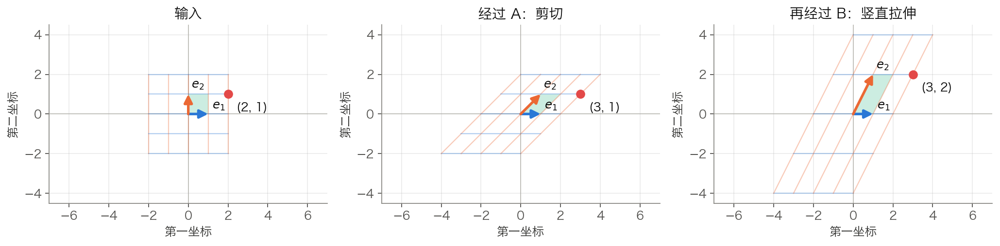
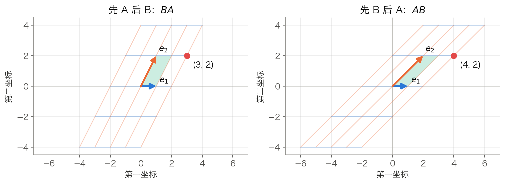

## 同一个点，先走两步

沿用剪切

\[
A=\begin{bmatrix}1&1\\0&1\end{bmatrix},\qquad A(s,t)^T=(s+t,t)^T.
\]

第二步只把高度翻倍，用

\[
B=\begin{bmatrix}1&0\\0&2\end{bmatrix}.
\]

输入 `(2,1)` 先到 `(3,1)`，再到 `(3,2)`。每次都这样算可以，但处理许多点时，我们希望先找到一个矩阵 \(C\)，以后只算 \(C\mathbf x\)，与这两步对所有输入都相同。

只让 \(C(2,1)^T=(3,2)^T\) 不够，很多矩阵都能算对这一个点。上一章告诉我们，应当跟踪两支基。

## 把两支基都走完

\(\mathbf e_1\) 经剪切仍是 `(1,0)`，再拉伸也不变。\(\mathbf e_2\) 经剪切成为 `(1,1)`，再拉伸成为 `(1,2)`。把最后输出排成列：

\[
C=\begin{bmatrix}1&1\\0&2\end{bmatrix}.
\]

两次线性变换接起来仍保留组合：例如 \(B(A\mathbf u+A\mathbf v)=B(A\mathbf u)+B(A\mathbf v)\)，数乘也一样。因此基的完整路线决定所有输入的路线。

直接展开任意 \((s,t)^T\)，两步得到 `(s+t,2t)`，而 \(C\) 也如此。我们找的是同一条规则，不是一点的巧合。

## 矩阵乘法为什么这样规定？

先 \(A\)、后 \(B\) 的合成记作 \(BA\)，因为实际表达是 \(B(A\mathbf x)\)：贴着输入的先作用。

若 \(A\) 的第 \(j\) 列是 \(\mathbf a_j\)，它就是第一步对 \(\mathbf e_j\) 的输出。第二步再处理这个输出，得到 \(B\mathbf a_j\)。所以

\[
BA=[B\mathbf a_1\ B\mathbf a_2\ \cdots\ B\mathbf a_n].
\]

这就是**矩阵乘法**。每列都做一次已经会的矩阵乘向量，而不是把两个表对应格子相乘。

例如本例第二列是 \(B(1,1)^T=(1,2)^T\)。其中第一项由 \(B\) 的第一行与 \(A\) 的第二列相乘再相加，第二项由第二行同样计算。通常说的“行乘列”，来自这里：

\[
(BA)_{ij}=\sum_k B_{ik}A_{kj}.
\]

## 尺寸相接，表示什么？

若 \(A\) 是 \(m\times n\)，输入有 \(n\) 项、输出有 \(m\) 项；第二步 \(B\) 必须接收这 \(m\) 项，所以是 \(p\times m\)。最后 \(BA\) 为 \(p\times n\)。中间尺寸相同，是因为上一份输出正是下一份输入。

先把 `(s,t)` 变成 `(s,t,s+t)`，再把三项相加，最后是 `2s+2t`，因此

\[
\begin{bmatrix}1&1&1\end{bmatrix}
\begin{bmatrix}1&0\\0&1\\1&1\end{bmatrix}
=\begin{bmatrix}2&2\end{bmatrix}.
\]

非方阵也能相乘，只要这条输入输出路线接得上。

## 交换顺序，到底改了哪里？

仍从 `(2,1)` 开始，这次先拉伸，到 `(2,2)`；剪切读取的是新高度 2，所以到 `(4,2)`，不是先前的 `(3,2)`。

对任意输入，先拉伸再剪切是 `(s+2t,2t)`，于是

\[
AB=\begin{bmatrix}1&2\\0&2\end{bmatrix},\qquad
BA=\begin{bmatrix}1&1\\0&2\end{bmatrix}.
\]

不是矩阵乘法故意古怪，而是第二步接收到的内容已经由第一步改变。某些操作可以交换，但不能把实数乘法的交换律直接搬来。

若再接 \(D\)，不换顺序，只改变计算分组，两边都依次做 \(A,B,D\)，所以 \((DB)A=D(BA)\)。每支基最终输出相同，矩阵便相同。这是尺寸相容时的**结合律**。

## 转置：把行列换一下

后面要把每行记录当成一列来做内积，需要另一种操作：**转置**。它不是复合，也不是撤销变换。

\[
H=\begin{bmatrix}1&2&3\\4&5&6\end{bmatrix},\qquad
H^T=\begin{bmatrix}1&4\\2&5\\3&6\end{bmatrix}.
\]

原第一行变成第一列。一般 \((H^T)_{ij}=H_{ji}\)，尺寸从 \(m\times n\) 变成 \(n\times m\)，再转置回到原表。

一行 \(\mathbf u^T\) 乘一列 \(\mathbf v\) 给出一个数；一列 \(\mathbf u\) 乘一行 \(\mathbf v^T\) 则给出一张表。这两个尺寸区别，会分别用于第十八章内积与第二十三章外积。

> [!DETAILS] 后面会用的乘积转置规则
> \((BA)^T=A^TB^T\)，顺序也倒过来。逐项看，\(((BA)^T)_{ij}=\sum_kB_{jk}A_{ki}=\sum_k(A^T)_{ik}(B^T)_{kj}\)，正好是右边对应元素。可以把它看成行、列角色互换后的同一次求和。

## 让两个实际操作走同一条路线

图像点 `(20,10)` 先剪切再拉高为 `(30,20)`，反过来是 `(40,20)`。矩阵合成精确描述坐标；软件逐次重采样像素与只在最后采样一次，画面细节仍可能不同。

房价一行数据 `(90,500)` 用米记录距离，先用 \(D=\operatorname{diag}(1,0.001)\) 换成公里，再用 \(w=[2,-10]\) 算价格。合成行向量是 \(wD=[2,-0.01]\)，仍得到 175 万。这次输入是房屋数据，系数已固定，不是第三章待求系数的那个输入。

[两次变换实验](https://colab.research.google.com/github/xiaoheng008/linear-algebra-evolution/blob/main/experiments/11_composition.ipynb)改变剪切量 \(k\)、拉伸倍数 \(h\)。两种路线分别为 `(s+kt,ht)` 与 `(s+kht,ht)`，差是 `(k(h−1)t,0)`。整个规则相同时，要对所有 \(t\) 都为零，故 \(k=0\) 或 \(h=1\)；仅看一个横轴点会漏掉差别。

下一章把路线倒过来走：哪种变换能撤销，哪种已经把输入的区别丢掉了？
