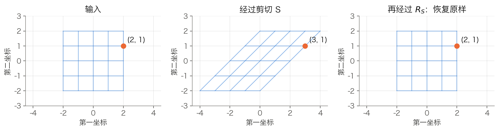

## 剪切以后，原来的点在哪里？

剪切把位置 `(s,t)` 变成 `(s+t,t)`。现在只看输出 `(3,1)`，原来的点应该是什么？

第二项保留了高度 1，从第一项减去它，就得到水平位置 2。找回原来的点不必靠猜：对任意输出 `(u,v)`，都做 `(u−v,v)`：

\[
S=\begin{bmatrix}1&1\\0&1\end{bmatrix},\qquad
R_S=\begin{bmatrix}1&-1\\0&1\end{bmatrix}.
\]

先剪切再恢复、先恢复再剪切，都回到原输入，直接乘得 \(R_SS=SR_S=I\)。单位矩阵 \(I\) 的作用是不改变任何向量。

图中没有像素裁剪或取整，讨论的是坐标的精确恢复。真正图片若额外丢失像素信息，坐标能恢复不意味着整张图片一定能恢复。

## 配料也能先求一条通用恢复规则吗？

原成分表为

\[
A=\begin{bmatrix}10&20\\20&10\end{bmatrix}.
\]

我们会从 `(1,2)` 算成分 `(50,40)`，也会用消元找回这份用量。但每换一份成分记录，都从头求一次并不方便。能否像剪切那样，提前整理出对任意记录都可用的规则？

把蛋白质、脂肪记为 \(P,F\)，用量记为 \(r,s\)：

\[
10r+20s=P,\qquad20r+10s=F.
\]

第二条减第一条的两倍，得 \(-30s=F-2P\)，再代回第一条：

\[
s=\frac{2P-F}{30},\qquad r=\frac{2F-P}{30}.
\]

这两项仍是输入坐标乘系数再相加，所以恢复本身也是矩阵：

\[
R=\frac1{30}\begin{bmatrix}-1&2\\2&-1\end{bmatrix},\qquad
\begin{bmatrix}r\\s\end{bmatrix}=R\begin{bmatrix}P\\F\end{bmatrix}.
\]

\(A\) 把用量（份）变成成分（克），\(R\) 把成分变回用量；它们的系数单位分别是克/份与份/克。代 `(50,40)` 得 `(1,2)`，代 `(40,50)` 得 `(2,1)`。

## 怎么确认不是只恢复对了几份？

需要检查整条规则。任意用量先经过 \(A\) 再经过 \(R\)，第一项为

\[
\frac{-(10r+20s)+2(20r+10s)}{30}=r,
\]

第二项同样为 \(s\)，所以 \(RA=I\)。反过来，从任意 \(P,F\) 用恢复公式得到用量，再产生的成分是

\[
10\frac{2F-P}{30}+20\frac{2P-F}{30}=P,
\quad
20\frac{2F-P}{30}+10\frac{2P-F}{30}=F,
\]

所以 \(AR=I\)。一个方向保证原输入能找回，另一个方向保证任意目标经恢复后确实产生原目标。

对 \(n\times n\) 方阵 \(A\)，这样的矩阵 \(R\) 叫**逆矩阵**，记为 \(A^{-1}\)；\(A\) 叫**可逆**。定义为 \(A^{-1}A=AA^{-1}=I\)，不是对每个格子取倒数。逐项倒数表乘 `(50,40)` 会得 `(7,6.5)`，并没有恢复用量。

若 \(A\mathbf x=\mathbf b\)，两边左乘逆得 \(\mathbf x=A^{-1}\mathbf b\)。乘法顺序来自撤销关系，不是把标量除法硬搬过来。逆若有两份 \(R,Q\)，则 \(R=R(AQ)=(RA)Q=Q\)，所以唯一。

## 换一个想法：恢复两种基本输出

到这里，恢复规则的意思已经清楚。接下来两节换两个角度看同一张表：这一节逐列求逆，下一节把消元也写成矩阵。第一次读时，先掌握逐列求逆和下面的 \([A\mid I]\) 计算；整体记录那一节可以留到需要时再细读。

求任意目标的规则，刚才用了带参数的消元。第十章还给过另一种思路：知道基的作用，就知道全部作用。

逆的第一列回答“要产生输出 \(\mathbf e_1=(1,0)^T\)，需要哪个输入？”第二列回答输出 \(\mathbf e_2=(0,1)^T\)。因此分别解

\[
A\mathbf r_1=\mathbf e_1,\qquad A\mathbf r_2=\mathbf e_2,
\]

得到 \(\mathbf r_1=(-1,2)^T/30,\mathbf r_2=(2,-1)^T/30\)。任意目标是 \(P\mathbf e_1+F\mathbf e_2\)，输入便为 \(P\mathbf r_1+F\mathbf r_2\)。它们排成的表正是 \(R\)。

这些单位输出的数学输入可能有负值，不是实际可用配方；我们正在建立实数线性关系的完整恢复规则。

## 右边放 I，原来是在同时解这些题

两组求列的方程左边相同，右边不同。放在一起：

\[
[A\mid I]=
\left[\begin{array}{cc|cc}10&20&1&0\\20&10&0&1\end{array}\right].
\]

右边不是添上的装饰，而是两份目标；它们一起接受相同消元。逐步做：

\[
\left[\begin{array}{cc|cc}1&2&1/10&0\\0&-30&-2&1\end{array}\right]
\longrightarrow
\left[\begin{array}{cc|cc}1&2&1/10&0\\0&1&1/15&-1/30\end{array}\right]
\longrightarrow
\left[\begin{array}{cc|cc}1&0&-1/30&1/15\\0&1&1/15&-1/30\end{array}\right].
\]

第一步先第一行除 10，再第二行减当前第一行的 20 倍；第二步除以 −30；最后第一行减第二行的两倍。左边成为 \(I\)，右边每列就是相应目标的解，所以得到 `[I|A⁻¹]`。

## 同一套操作，也可以整体记录

消元处理整行，左乘一个矩阵恰好也能组合各行。例如第一行除 10 是左乘 \(E_1=\operatorname{diag}(1/10,1)\)，第二行减第一行的20倍是左乘 \(E_2=\begin{bmatrix}1&0\\-20&1\end{bmatrix}\)。

后两步分别是 \(E_3=\operatorname{diag}(1,-1/30)\)、\(E_4=\begin{bmatrix}1&-2\\0&1\end{bmatrix}\)。完整操作 \(E=E_4E_3E_2E_1\) 把 \(A\) 变成 \(I\)，把原来的 \(I\) 变成 \(E\) 自己：

\[
E[A\mid I]=[EA\mid EI]=[I\mid E].
\]

于是右边既是各个基本目标的解，也是执行完整消元的矩阵。逐列看恢复目标，逐行看简化条件，整体看撤销变换，三种解释对上了。

> [!DETAILS] 二阶逆公式的乘法检查
> 对 \(M=\begin{bmatrix}a&b\\c&d\end{bmatrix}\)，令 \(J=\begin{bmatrix}d&-b\\-c&a\end{bmatrix}\)，相乘有 \(MJ=JM=(ad-bc)I\)。当 \(ad-bc\ne0\) 时，\(M^{-1}=J/(ad-bc)\)。第十六章会解释这个数怎样连接消元、面积与可逆性；现在不用先背公式。

## 两个输入已经合在一起时，恢复会遇到什么？

把乙的贡献换成甲的两倍：

\[
C=\begin{bmatrix}10&20\\20&40\end{bmatrix}.
\]

输入 `(2,0)` 与 `(0,1)` 都得到 `(20,40)`。只看到这份记录，任何固定恢复规则只能选一个结果，不可能同时找回两个不同原输入。

还有目标根本达不到，例如 `(50,40)` 不满足脂肪等于蛋白质两倍。因此可逆要求的不只是某个输出有解，而是每个实数目标都有唯一输入。

对方阵，消元能化成 \(I\) 时具备这个能力；缺主元时，齐次方程组 \(A\mathbf z=0\)（右端全为零）有非零解，零输入与该非零输入便有相同输出。于是列构成基、主元齐全、任意目标唯一可解、存在逆矩阵，是同一件事的不同读法。实际非负限制仍另算，例如原 \(A\) 对 `(10,0)` 的唯一实数用量为 `(-1/3,2/3)`，不能实际配料。

## 多步恢复，要从最后一步开始

先剪切 `(2,1)→(3,1)`，再把高度翻倍为 `(3,2)`。恢复时先除掉高度的倍数，回 `(3,1)`，再减原高度回 `(2,1)`。先减当前高度反而会错，因为它已经翻倍。

一般先 \(A\) 后 \(B\) 是 \(BA\)，先撤销 \(B\) 再撤销 \(A\)，所以 \((BA)^{-1}=A^{-1}B^{-1}\)。两个乘积方向都可以用结合律核对为 \(I\)。

[逆矩阵实验](https://colab.research.google.com/github/xiaoheng008/linear-algebra-evolution/blob/main/experiments/12_inverse.ipynb)分别检查任意目标、逐列恢复、消元记录和不同输入合并。数值计算只解一份方程时通常直接用求解器，不需要先显式求逆；本章求的是完整恢复规则。

既然有的输出不止一个输入，下一章就不再勉强恢复一份，而是问：怎样把所有可能输入一个不漏地写出来？

可与 [MIT 18.06 第三讲](https://ocw.mit.edu/courses/18-06-linear-algebra-spring-2010/resources/lecture-3-multiplication-and-inverse-matrices/)对照逐列求逆与消元矩阵的解释；这里的例子和文字独立编写。
