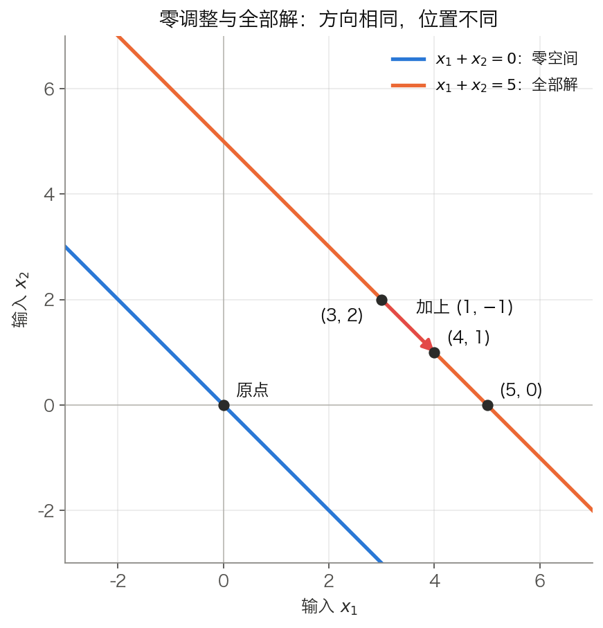

## 只记下和，哪些输入仍然分不清？

规则很简单：输入两个数，只输出它们的和，\(A=[1\ 1]\)。记录为 5，可能来自 `(3,2)`，也可能来自 `(4,1)`。

我们已经知道不能唯一恢复，但列出几个候选还没有描述所有候选。一个有用的想法是：先找到一份，再找哪些调整不影响输出。

从 `(3,2)` 改成 `(4,1)`，输入多了 `(1,−1)`。这份调整的和为零。原来我们不必分别研究每个非零目标：**同样输出的两份输入，其差正好是零输出的输入。**

## 先找全零输出的调整

零输出要求 \(z_1+z_2=0\)，所以选定第一项 \(t\)，第二项必须为 \(-t\)。全部输入是

\[
\mathbf z=t(1,-1)^T,\qquad t\in\mathbb R.
\]

这不是几个样本的总结：任何和为零的输入都满足第二项是第一项相反数，没有其他形式。

所有被 \(A\) 送到零的输入组成**零空间**，记为

\[
N(A)=\{\mathbf z:A\mathbf z=0\}.
\]

这里它是一条输入平面里的直线。`(1,−1)` 是其中一支向量，全部倍数才是整个空间；“零”指输出，不是说只有零输入。

## 加到一份解上，会发生什么？

先选特解 \(\mathbf x_p=(5,0)^T\)。加上零调整，得到

\[
\mathbf x=(5,0)^T+t(1,-1)^T=(5+t,-t)^T.
\]

无论 \(t\) 怎么变，和仍为 5。要得到 `(3,2)`，取 \(t=-2\)；要得到 `(4,1)`，取 \(t=-1\)。

会不会还有其他解不在这里？任意和为5的输入取 \(t=-x_2\)，便有 \(x_1=5-x_2=5+t\)，所以也在这个形式里。我们既生成正确解，也排除了遗漏。

蓝线是零空间，橙线是目标为5的全部输入。两图都在输入坐标里，方向相同，位置不同。

## 这个办法为什么不只适用于加法？

设已有 \(A\mathbf x_p=\mathbf b\)。零空间向量 \(\mathbf z\) 满足 \(A\mathbf z=0\)，因此

\[
A(\mathbf x_p+\mathbf z)=A\mathbf x_p+A\mathbf z=\mathbf b.
\]

反过来，任何另一解 \(\mathbf x\) 都有

\[
A(\mathbf x-\mathbf x_p)=\mathbf b-\mathbf b=0.
\]

所以两份解的差一定在零空间。只要目标有解，全部解恰好是

\[
\mathbf x=\mathbf x_p+\mathbf z,\qquad\mathbf z\in N(A).
\]

没有特解时不能使用这个式子。零空间只有零向量时，有解就唯一；有非零方向时，加它的任意倍数便有无穷多个解。

零空间之所以是子空间，是因为两个零输出输入相加仍零输出，任意实数倍也如此，并含零向量。非零目标的解集不含零向量，不是子空间；它是沿零空间方向平移的一整份集合。

## 不可见的调整，可能不止一个方向

用三个测量记录四个输入：

\[
B=\begin{bmatrix}0&1&2&1\\1&2&3&1\\2&5&8&3\end{bmatrix}.
\]

先找 \(B\mathbf z=0\)。四个未知量、三条方程，消元要一步一步记。

第一行没有 \(z_1\)，第二行有，所以先交换前两行：

\[
\begin{bmatrix}1&2&3&1\\0&1&2&1\\2&5&8&3\end{bmatrix}.
\]

第三行减第一行的两倍，消掉 \(z_1\)：

\[
\begin{bmatrix}1&2&3&1\\0&1&2&1\\0&1&2&1\end{bmatrix}.
\]

第三行现在和第二行完全一样。再相减，第三行变成全零：

\[
\begin{bmatrix}1&2&3&1\\0&1&2&1\\0&0&0&0\end{bmatrix}.
\]

在这里停一下。零行不是计算碰巧抵消了。它说明原来的第三条测量没有提供新的限制，它的信息已经包含在前两条里。三次测量，实际只有两条独立的要求。

最后让第一行减去第二行的两倍，消掉第一行里的 \(z_2\)，得到

\[
R=\begin{bmatrix}1&0&-1&-1\\0&1&2&1\\0&0&0&0\end{bmatrix}.
\]

行操作可撤销，所以零输出的输入没有变。

现在读回两条方程：\(z_1=z_3+z_4\)，\(z_2=-2z_3-z_4\)。第三、第四项没有主元，可以自由选；选好以后，前两项就被确定。把自由的两项记作 \(s,t\)：

\[
\mathbf z=(s+t,-2s-t,s,t)^T
=s(1,-2,1,0)^T+t(1,-1,0,1)^T.
\]

右边这两支向量是怎样来的？让 \(s=1,t=0\)，回代得到第一支；让 \(s=0,t=1\)，得到第二支。它们也叫齐次方程组（右端全为零）的**特殊解**。注意别和下面非零目标的“特解”混淆：特殊解负责不可见的调整，特解负责达到目标。

为什么这两支恰好构成零空间的基？分两件事检查。

**不重复。** 看它们的第三、第四项，分别是 `(1,0)` 和 `(0,1)`。若 \(a(1,-2,1,0)^T+b(1,-1,0,1)^T=0\)，只看这两项就得到 \(a=b=0\)，所以两支线性无关。

**不遗漏。** 任取一个零输出输入，它的第三、第四项是某两个数 \(s,t\)；方程又迫使前两项等于 \(s+t\) 和 \(-2s-t\)。所以它正好是 \(s\) 倍第一支加 \(t\) 倍第二支。

既张成零空间，又线性无关，它们就是零空间的一组基。

## 再求非零目标，右端也跟着走

目标为 \((2,5,12)^T\)。相同操作把右端依次变为 `(5,2,12)`、`(5,2,2)`、`(5,2,0)`、`(1,2,0)`。因此

\[
x_1-x_3-x_4=1,\qquad x_2+2x_3+x_4=2.
\]

自由变量先取零，得到特解 `(1,2,0,0)`；全部解是

\[
\mathbf x=(1,2,0,0)^T+s(1,-2,1,0)^T+t(1,-1,0,1)^T.
\]

特解负责目标，两个特殊解负责不影响目标的调整。把目标最后一项改成13，则最后零行变成 \(0=1\)，无解。自由方向本身没有改变，目标相容性却变了。

## 三根绳子的所有分配

回到第七章。左右斜绳方向是 `(-0.6,0.8)`、`(0.6,0.8)`，再加竖直绳 `(0,1)`，要求合力向上80牛顿。水平平衡给 \(T_L=T_R\)，竖直要求 \(0.8T_L+0.8T_R+T_V=80\)。

令竖直张力 \(T_V=t\)，得到

\[
(T_L,T_R,T_V)^T=(50,50,0)^T+t(-0.625,-0.625,1)^T.
\]

竖直多拉1牛顿，两根斜绳各少拉0.625，输出看不出变化。调整向量在输入的零空间，不是输出中的某支力方向。

三项张力非负时留下 \(0\le t\le80\)。例如 \(t=40\) 时左右各25牛顿；\(t=80\) 时全由竖直承担。平衡只给可能集合，实际分担还需伸长、刚度等条件。

## 自己找一个新的不可见方向

把两个数的记录改成 \(2x_1+3x_2\)。不运行求解器，写出零空间和输出为6的全部输入。

> [!DETAILS] 方向提示
> 先让第三个倍数与第二个倍数抵消，找一支非零方向；再找一份容易核对的特解。

> [!DETAILS] 核对
> 零空间为 \(t(3,-2)^T\)；特解可取 `(3,0)`，全部输入为 \((3,0)^T+t(3,-2)^T\)。由一条方程回代可确认这些是全部解，不只是猜中的几份。

[零空间与全部解实验](https://colab.research.google.com/github/xiaoheng008/linear-algebra-evolution/blob/main/experiments/13_solution_sets.ipynb)依次检查零调整、两个自由变量以及绳索区间。

我们已经找到不可见的变化。下一章再看新增测量：它是消除了这些变化，还是只是重复写下已经知道的事？

零输出先于完整解的引导可对照 [MIT 18.06 第六讲](https://ocw.mit.edu/courses/18-06-linear-algebra-spring-2010/bdefda5baee6ea0053bcd56eccabed15_MIT18_06S10_L06.pdf)，本文例子和推导独立编写。
