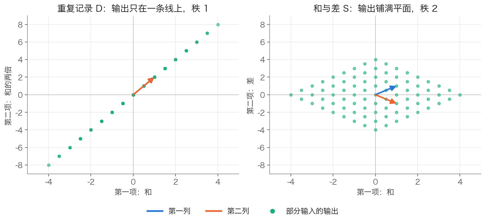

## 多记一个数，就能恢复更多吗？

只知道 \(x_1+x_2=5\)，\((3,2)\) 与 \((4,1)\) 分不清。上一章找出它们相差的不可见方向 \((1,-1)\)。现在允许多测一次，能否找回原输入？

先记录和的两倍：

\[
x_1+x_2=5,\qquad2x_1+2x_2=10.
\]

两组输入仍给相同记录。第二条减第一条两倍为 \(0=0\)，旧自由选择一个也没减少。新增的是一条文字记录，不是一条新的限制。

若改为记录差 \(x_1-x_2=1\)，\((4,1)\) 就不符合了。两式相加给 \(x_1=3\)，代回得 \(x_2=2\)。不可见变化现在要同时满足和、差都为零，只能是零向量。

区别在于新测量能否发现原来无法分辨的变化，而不在于表里写了几行。

## 同样两个输出，范围为什么不同？

两种规则分别是

\[
D=\begin{bmatrix}1&1\\2&2\end{bmatrix},\qquad
S=\begin{bmatrix}1&1\\1&-1\end{bmatrix}.
\]

\(D\) 的输出只能为 \((p,2p)\)，在一条线上。\(S\) 给任意 \((p,q)\) 都可选 \(x_1=(p+q)/2,x_2=(p-q)/2\)，因此遍及平面。

输出范围就是各列的张成，叫**列空间** \(\operatorname{Col}(A)\)。它的维数叫矩阵的**秩**：

\[
\operatorname{rank}(A)=\dim\operatorname{Col}(A).
\]

所以 \(D\) 秩1，\(S\) 秩2。这个数说明输出能独立变化几个方向，不能把输出坐标数或非零格子数直接当成它。

## 三个输入，只做两次独立测量

记录前两项之和与后两项之和：

\[
B=\begin{bmatrix}1&1&0\\0&1&1\end{bmatrix},\qquad
x_1+x_2=p,\quad x_2+x_3=q.
\]

给任意 \(p,q\)，取 \((p,0,q)\) 就达到目标，所以输出范围二维。中间数 \(x_2=t\) 却可以任意选，全部输入为

\[
(p-t,t,q-t)^T=(p,0,q)^T+t(-1,1,-1)^T.
\]

输入三项，输出保留两个独立方向，剩一个不可见方向。是否总有这样的计数关系？先把消元与这两个数对上，而不是从几组例子猜公式。

## 主元数怎样同时解释两侧？

第一行减第二行，得到

\[
R=\begin{bmatrix}1&0&-1\\0&1&1\end{bmatrix}.
\]

前两列有主元，第三项自由。零输出要求 \(z_1=z_3,z_2=-z_3\)，所以零空间有一个基向量 \((1,-1,1)\)，与前面方向相反，但张成同一条线。

主元列为什么也数输出的秩？消元后两个主元列独立，第三列是它们的组合。行操作都可以撤销，因此化简前后保留各列之间的线性关系：一组系数把原列组合为零，化简列也为零，反过来也成立。无关性与张成需要的列数因此相同。

具体列空间的基却要取**原矩阵对应位置的列**，不是化简后的列；消元改变了输出坐标，通常改变实际列空间。

## 两个自由变量时，还是这个计数吗？

上一章四输入矩阵的化简结果为

\[
B_4=\begin{bmatrix}0&1&2&1\\1&2&3&1\\2&5&8&3\end{bmatrix}
\longrightarrow
\begin{bmatrix}1&0&-1&-1\\0&1&2&1\\0&0&0&0\end{bmatrix}.
\]

两个主元在第1、2列，另两项自由。零空间基已经逐项求出：\((1,-2,1,0)\)、\((1,-1,0,1)\)，维数为2。

原列空间的基则是 \(\mathbf c_1=(0,1,2)^T,\mathbf c_2=(1,2,5)^T\)。另外两列分别为 \(-\mathbf c_1+2\mathbf c_2\)、\(-\mathbf c_1+\mathbf c_2\)，所以秩也为2。

化简后的第一列 \((1,0,0)\) 不在原输出范围里：原输出必须满足第三项等于第一项加第二项的两倍。这是“保留列关系”不等于“保留每个列向量”的具体区别。

## 从自由坐标走到一般维数

一般 \(m\times n\) 矩阵消出 \(r\) 个主元。主元列无关，其他列由它们表示，所以秩是 \(r\)。剩下 \(n-r\) 个自由变量。

每次一个自由变量取1，其余取0，回代得到一个齐次特殊解。它们在自由位置各有自己的一个1，因此无关；任意解的自由取值又能这样组合，主变量随后由方程确定，所以张成全部零空间。

于是

\[
\operatorname{rank}(A)+\dim N(A)=n.
\]

这叫**秩-零化度定理**。右边是输入坐标数，不是方程条数；先去掉重复关系，才知道哪些变量真正被约束。

## 再加测量，怎样判断是否有用？

对三输入的 \(B\)，新增 \(x_1+2x_2+x_3\) 只是旧两项相加，仍看不见 \((-1,1,-1)\)。改记录总和 \(x_1+x_2+x_3=s\)，代入全部解却给

\[
p+q-t=s,\qquad t=p+q-s.
\]

最后自由变量被确定，秩变3。对两个自由方向的例子，新增一条线性测量至多减少一个自由度；要检查它对整片零空间的作用，不能只试其中一个向量。

## 输出之间的关系，也能记成一个空间

重复记录 \(D\) 的目标 \((5,11)\) 不相容，因为第二项必须是第一项两倍。用 \(\mathbf y=(-2,1)^T\) 记这条关系，便有 \(\mathbf y^TD=0\)，可达目标必须 \(\mathbf y^T\mathbf b=0\)。所有这样的 \(\mathbf y\) 构成**左零空间** \(N(A^T)\)，位于输出坐标空间，与输入零空间不同。

各行的组合构成**行空间**。行操作不改它，阶梯形恰有 \(r\) 个独立非零行，所以行空间也维数 \(r\)，即 \(\operatorname{rank}(A^T)=r\)。对转置再用本章计数，左零空间维数 \(m-r\)。

我们现在得到四个空间的个数，但尚未讨论它们为什么彼此垂直。第十八章有内积以后，会用同一个矩阵把四个空间全部求出并连接起来。

[新增测量实验](https://colab.research.google.com/github/xiaoheng008/linear-algebra-evolution/blob/main/experiments/14_rank.ipynb)先测试不可见方向是否被新测量发现，再用数值秩核对。图只显示样本；一般计数来自上面的主元和自由变量。

可以用本章的 \(B\) 自己试一条“只记录 \(x_2\)”的新增测量，说明它为什么有用，而“再记录两次旧测量的和”为什么没用。接下来不再只记录一次输出，而让同一矩阵反复作用，看看有没有容易追踪的变化。

主元与自由变量可对照 [MIT 18.06 第七讲](https://ocw.mit.edu/courses/18-06-linear-algebra-spring-2010/1d48511dfc3158b035ab92820c9a41cd_MIT18_06S10_L07.pdf)。本章测量例子与文字独立编写。
