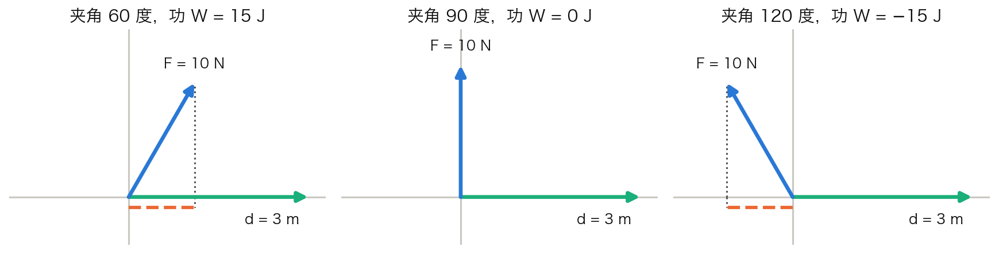

## 算出了差，还要决定怎样比较

图片目标位置是 \((3,4)\)，候选位置是 \((2,4)\) 与 \((3,2)\)，误差分别为 \((1,0)\) 与 \((0,2)\)。两方向像素尺度相同时，勾股定理给出距离1与2，前者更近。

可见误差向量告诉我们各方向差多少，而“哪个更小”还需要一个比较规则。沿用欧氏距离，定义

\[
\|\mathbf x\|=\sqrt{\sum_i x_i^2},\qquad
\operatorname{dist}(\mathbf x,\mathbf y)=\|\mathbf x-\mathbf y\|.
\]

负误差并不比正误差更小，平方避免相互抵消。长度非负，只有零向量长为零。

这一章分两半。上半讲长度与垂直，下一章的投影只用到这一半。下半用垂直重新看第十四章留下的问题：零空间与矩阵的行是什么关系，到不了的目标又遵循什么规律。

## 两份变化相加，长度也相加吗？

沿 \((1,0)\) 走1，再沿 \((0,1)\) 走1，总位移 \((1,1)\) 长 \(\sqrt2\)，不是2。平方长度却为 \(1+1=2\)。为什么这个关系在垂直方向成立？

展开一般向量的平方长度：

\[
\|\mathbf u+\mathbf v\|^2
=\sum_i(u_i+v_i)^2
=\|\mathbf u\|^2+2\sum_i u_iv_i+\|\mathbf v\|^2.
\]

中间的对应坐标乘积之和，记录两份变化相互配合的程度。它叫实向量的**内积**：

\[
\mathbf u^T\mathbf v=\sum_i u_iv_i.
\]

写法里的 \(\mathbf u^T\) 是第四章的转置：把列向量放倒成一行。按矩阵乘法，一行乘一列只剩一个数，正好是对应坐标相乘再相加。自己与自己的内积就是长度平方；交换两个向量，内积不变。

二维中内积为 \(\|\mathbf u\|\|\mathbf v\|\cos\theta\)，高维也用此式定义非零向量的夹角。内积为零称**正交**；此时刚才的交叉项消失，平方长度可直接相加。零向量与所有向量正交，但没有方向或夹角。

## 为什么单位正交基能直接取坐标？

第八章的 \((1,1)\) 与 \((1,-1)\) 内积 \(1-1=0\)，各长 \(\sqrt2\)。除以长度得

\[
\mathbf q_1=(1,1)^T/\sqrt2,\qquad
\mathbf q_2=(1,-1)^T/\sqrt2.
\]

它们相互正交，每个长1，构成**正交单位基**。若 \(\mathbf x=c_1\mathbf q_1+c_2\mathbf q_2\)，与 \(\mathbf q_1\) 内积时第一项留下 \(c_1\)，第二项为零。与另一个内积同理，所以无需再消元便得到系数。

对 \((3,1)\)，系数为 \(4/\sqrt2=2\sqrt2\)、\(2/\sqrt2=\sqrt2\)。旧的 \((2,1)\) 是非单位基下的坐标，基长度变了，系数也得变。现在平方长度直接为 \(8+2=10\)，与原来的 \(3^2+1^2\) 一致。

一般 \(\mathbf x=\sum_i c_i\mathbf q_i\) 都有 \(c_i=\mathbf q_i^T\mathbf x\)、\(\|\mathbf x\|^2=\sum_i c_i^2\)。

把基向量按列排成矩阵 \(Q\)，这些内积能一次写出来。为此要把整个矩阵转置：每一行变成对应的一列，记作 \(Q^T\)。例如

\[
H=\begin{bmatrix}1&2&3\\4&5&6\end{bmatrix},\qquad
H^T=\begin{bmatrix}1&4\\2&5\\3&6\end{bmatrix}.
\]

\(Q^T\) 的第 \(i\) 行就是 \(\mathbf q_i^T\)，所以 \(Q^TQ\) 第 \(i\) 行第 \(j\) 列的数正是内积 \(\mathbf q_i^T\mathbf q_j\)：自己与自己为 1，不同的为 0。于是 \(Q^TQ=I\)；完整基时 \(Q\) 是方阵，\(Q^{-1}=Q^T\)，而且

\[
\|Q\mathbf c\|^2=\mathbf c^TQ^TQ\mathbf c=\|\mathbf c\|^2.
\]

只有子空间的基时，\(Q\) 可以长方形，仍有 \(Q^TQ=I\)，不能写普通逆；下一章解释 \(QQ^T\) 的作用。

## 物理中，同一个求和为什么量出功？

恒力 \((6,8)\) 牛顿，物体只水平移动 \((3,0)\) 米。竖直分量对这段位移不做功，因此仍是 \(6\times3=18\) 焦耳，不是总力长10乘位移长3。

改为位移 \((3,4)\) 米，两者同向，功为 \(6\times3+8\times4=50\) 焦耳，等于力长10乘位移长5。对恒力和直线位移，一般有

\[
W=\mathbf F^T\mathbf d=\|\mathbf F\|\|\mathbf d\|\cos\theta.
\]

沿位移、垂直、反向分别做正、零、负功。内积的用途不只是判断垂直，还能量出一个向量在另一方向上发挥了多少作用。

位移都向右，虚线标出力的水平分量。力与位移单位不同，绘图尺度也不同，不能比较两箭头的画面长度。[OpenStax 的恒力做功说明](https://openstax.org/books/university-physics-volume-1/pages/7-1-work)可作物理背景参考。

还有一点要提防：只有单位相同的量才能直接平方相加。面积差和距离差单位不同，要先说清各自按什么尺度换算，才能算总误差。

## 下半：一个矩阵的四个空间

第十四章找过两样东西：输入里看不见的变化（零空间），以及输出能到达的范围（列空间）。还剩两个问题。

**到不了的目标遵循什么规律？** 重复记录 \(D=\begin{bmatrix}1&1\\2&2\end{bmatrix}\) 的输出总满足 \(-2b_1+b_2=0\)。把系数记成 \(\mathbf y=(-2,1)^T\)，这条规律就是 \(\mathbf y^T\mathbf b=0\)。它对每个输出成立，等价于 \(\mathbf y\) 与 \(D\) 的每一列内积为零，也就是 \(\mathbf y^TD=0\)。

**零空间和矩阵的行有什么关系？** \(A\mathbf z=0\) 逐行读，就是 \(\mathbf z\) 与每一行内积为零。

两个问题都在问“与什么垂直”。为了把它们写成同一种形式，再引入两个名字。矩阵各行所有组合构成的空间叫**行空间**；满足 \(\mathbf y^TA=0\) 的全部 \(\mathbf y\) 叫**左零空间**。把 \(\mathbf y^TA=0\) 两边转置，就是 \(A^T\mathbf y=0\)，所以左零空间记作 \(N(A^T)\)。

> [!DETAILS] 乘积转置为什么要倒过来
> \((BA)^T=A^TB^T\)，顺序要倒过来。逐项看，\(((BA)^T)_{ij}=\sum_kB_{jk}A_{ki}=\sum_k(A^T)_{ik}(B^T)_{kj}\)，正好是右边对应位置的数。用在上面：\((\mathbf y^TA)^T=A^T\mathbf y\)。

现在用一个三阶矩阵把四个空间都求出来。继续前后两项之和的测量，再重复记录两次和：

\[
C=\begin{bmatrix}1&1&0\\0&1&1\\1&2&1\end{bmatrix}.
\]

零输出要求 \(z_1+z_2=0,z_2+z_3=0\)，因此输入零方向为 \((1,-1,1)\)。它与每一行内积都零——这就是零输出方程本身。

前两行独立，第三行是它们的和，行空间由 \((1,1,0)\)、\((0,1,1)\) 张成。与这两个正交，就与全部行组合正交。因此所有行方向都看不见的变化，恰好是零空间，不只是其中几个箭头。

再看输出：第一、第三列是 \((1,0,1)\)、\((0,1,1)\)，第二列是它们的和，全部输出为 \((p,q,p+q)^T\)。要求向量与两列都正交，方程 \(y_1+y_3=0,y_2+y_3=0\)，得到 \((-1,-1,1)\)。

| 坐标所在一侧 | 空间 | 一组基 | 维数 |
| --- | --- | --- | --- |
| 输入 | 行空间 | \((1,1,0)\)、\((0,1,1)\) | 2 |
| 输入 | 零空间 | \((1,-1,1)\) | 1 |
| 输出 | 列空间 | \((1,0,1)\)、\((0,1,1)\) | 2 |
| 输出 | 左零空间 | \((-1,-1,1)\) | 1 |

输入三项是原量，输出三项是测量，坐标数相同不表示含义相同。不能拿输入零方向当成输出的相容关系。

与子空间 \(W\) 每个向量正交的全体叫**正交补** \(W^\perp\)。逐行、逐列读方程，分别得到

\[
N(A)=\operatorname{Row}(A)^\perp,\qquad
N(A^T)=\operatorname{Col}(A)^\perp.
\]

反过来，行空间是不是恰好等于零空间的正交补？先算正交补有多大。若 \(W\subseteq\mathbb R^d\) 有 \(r\) 个基向量，“与 \(W\) 正交”就是与这 \(r\) 个基向量都正交。把这些基的转置排成 \(r\) 行，就得到一个秩为 \(r\) 的齐次方程组；第十四章的计数给出 \(\dim W^\perp=d-r\)。

现在完整走一遍行空间这一对。设 \(A\) 有 \(n\) 列、秩 \(r\)。

1. **包含。** 零空间里的每个 \(\mathbf z\) 都与每一行正交，所以也与行的所有组合正交。因此行空间的每个向量都在 \(N(A)^\perp\) 里。
2. **维数。** 行操作只是把行彼此组合，能倒回去，所以不改变行的组合范围；化成阶梯形后恰有 \(r\) 个非零行，它们无关，所以行空间维数是 \(r\)。零空间维数是 \(n-r\)，所以它的正交补维数是 \(n-(n-r)=r\)。
3. **相等。** 一个 \(r\) 维空间装在另一个 \(r\) 维空间里，二者必定相等：行空间的 \(r\) 个基向量在 \(N(A)^\perp\) 里仍然无关；若它们没张满 \(N(A)^\perp\)，还能再加一个无关向量，得到 \(r+1\) 个无关向量，与第九章“无关向量不超过维数”矛盾。

所以 \(\operatorname{Row}(A)=N(A)^\perp\)。把 \(A\) 换成 \(A^T\)，同样三步给出 \(\operatorname{Col}(A)=N(A^T)^\perp\)。

于是回答了第一个问题：目标可达，恰好等于它与左零空间里的每个向量都正交。本例 \((2,3,5)\) 内积零、可达，\((2,3,6)\) 内积1、不可达；任何 \((p,q,p+q)\) 又可由输入 \((p,0,q)\) 得到。下一章就处理那个到不了的目标。

## 选读：对称矩阵与谱定理

这一节第一次读可以跳过，第二十二、二十四章用到时再回来。

第十五章的 \(\begin{bmatrix}3&1\\1&3\end{bmatrix}\)，特征向量 \((1,1)\)、\((1,-1)\) 恰好互相垂直，归一化后正是上半的 \(\mathbf q_1,\mathbf q_2\)。所以它可以写成 \(Q\operatorname{diag}(4,2)Q^T\)，而且 \(Q\) 的逆就是 \(Q^T\)。

这不是巧合。这个矩阵转置以后仍是自己，即 \(A^T=A\)，主对角线两侧对应位置的数相同，叫**实对称矩阵**。**实对称矩阵谱定理**保证：每个实对称矩阵都有一组完整的正交单位特征基，特征值重复时也是如此。第二十二章证明一般矩阵都有 SVD 时，用的就是这个定理。

> [!DETAILS] 为什么不同特征值的特征向量互相垂直
> 若 \(A\mathbf v=\lambda\mathbf v,A\mathbf w=\mu\mathbf w\)，由 \((A\mathbf v)^T=\mathbf v^TA^T=\mathbf v^TA\) 得
> \[
> \lambda\mathbf v^T\mathbf w=(A\mathbf v)^T\mathbf w=\mathbf v^TA\mathbf w=\mu\mathbf v^T\mathbf w.
> \]
> 若 \(\lambda\ne\mu\)，只能 \(\mathbf v^T\mathbf w=0\)。但这只说明已有的方向互相垂直，还没证明方向一定够用；那正是下面谱定理要补的。

> [!DETAILS] 进阶存在性证明：需要极值与求导
> 连续函数 \(x^TAx\) 在紧的单位球面取得最大值。设单位最大方向为 \(v\)，任意 \(w\perp v\) 的球面路径 \((v+tw)/\|v+tw\|\) 在零处导数为零，给 \(w^TAv=0\)。所以 \(Av\) 垂直全部 \(v\) 的正交补，即 \(Av=\lambda v\)。
>
> 对 \(w\perp v\)，有 \(v^TAw=(Av)^Tw=0\)，其正交补在变换下保持不变。限制到该低一维空间，变换仍对称，归纳得到完整正交单位特征基。
>
> 这使用分析知识，不仅是消元。尚未学过时可以接受已说明适用范围的定理，基础内积与四空间计算无需这段证明。

[长度与四空间实验](https://colab.research.google.com/github/xiaoheng008/linear-algebra-evolution/blob/main/experiments/18_inner_product.ipynb)检查坐标平方、输入与输出各自的零方向；[恒力做功实验](https://colab.research.google.com/github/xiaoheng008/linear-algebra-evolution/blob/main/experiments/physics_work.ipynb)改变夹角，比较方向分量而不是只看力长。
