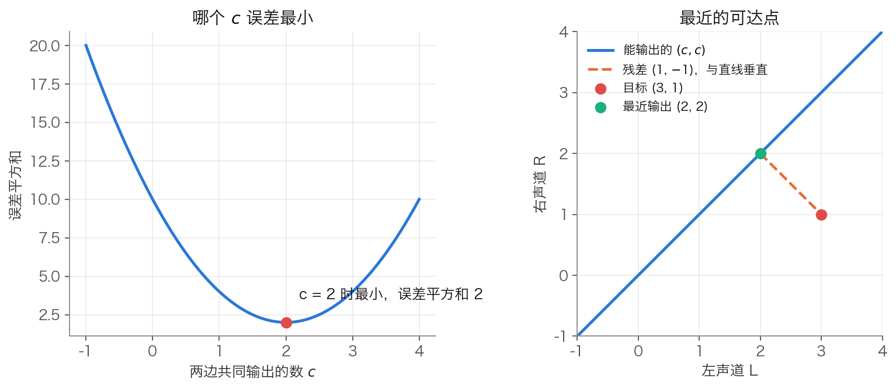

## 目标不能输出，仍可以问误差最小是多少

目标双声道采样 `(3,1)`，设备只能把同一数 \(c\) 送到两边，输出 `(c,c)`。不可能精确达到目标。

若 \(c=1\)，误差 `(2,0)` 平方和4；若 \(c=3\)，误差 `(0,−2)` 也为4。中间 \(c=2\) 给 `(1,−1)`，平方和2，更小。只比三个候选仍不够，所以把任意候选展开：

\[
(3-c)^2+(1-c)^2=2(c-2)^2+2.
\]

平方项只有在 \(c=2\) 为零，因此 `(2,2)` 是唯一最近输出。残差 `(1,−1)` 与输出直线方向 `(1,1)` 正交。

这就是第八章删除差别坐标后的结果；现在补上的结论是：按左右等权平方误差，它最接近原双声道。

## 最近点的残差为什么值得检查？

假设已找到子空间 \(W\) 的点 \(\mathbf p\)，残差 \(\mathbf r=\mathbf b-\mathbf p\) 与 \(W\) 正交。换成任意 \(\mathbf w\in W\)，误差是

\[
\mathbf b-\mathbf w=\mathbf r+(\mathbf p-\mathbf w).
\]

后一项在 \(W\)，所以两项正交，平方长度为

\[
\|\mathbf b-\mathbf w\|^2=\|\mathbf r\|^2+\|\mathbf p-\mathbf w\|^2.
\]

新候选只会增加一项，只有 \(\mathbf w=\mathbf p\) 不增加。这覆盖了所有候选，证明最近点唯一。它叫**正交投影**。

由此可以倒过来找点：**既要在可达空间里，又要把残差留在垂直方向上。**

## 用刚才的法向量，找平面上的最近点

上一章平面 \(W:z=x+y\)，垂直方向已算为 \(\mathbf n=(-1,-1,1)^T\)。目标 \(\mathbf b=(2,3,6)^T\) 不满足关系：第三项比前两项之和多 1。这个 1 是记录不一致的差额，还不是点到平面的距离；稍后会看到，距离的平方只有 \(1/3\)。

先只把第三项改成5，得到 `(2,3,5)`，平方误差1。但三个坐标同权，为什么只允许第三项承担修改？它在平面上，却未必最近。

要使残差垂直，应从目标减去 \(c\mathbf n\)，得到

\[
\mathbf p=(2+c,3+c,6-c)^T.
\]

再让它符合平面条件：\(6-c=(2+c)+(3+c)\)，得 \(c=1/3\)。于是

\[
\mathbf p=(7,10,17)^T/3,\qquad
\mathbf r=(-1,-1,1)^T/3.
\]

残差平方为 \(1/3\)，比只改第三项好。更重要的是它在正确位置、残差也在正确方向，前面的勾股证明保证没有更好点。旧候选与它距离平方 \(2/3\)，正好 \(1=1/3+2/3\)。

平面关系和上一章求出的垂直方向，已经足够确定最近点。

## 也可以沿空间内部取坐标

更多维数时，有时空间内部基比法向量方便。仍从平面原基 `(1,0,1)`、`(0,1,1)` 出发。第一支除以长度，得 \(q_1=(1,0,1)^T/\sqrt2\)。

第二支想同时在平面里、垂直第一支。设 `(a,b,c)`，条件为 \(c=a+b\)、\(a+c=0\)。取 \(a=-1\)，便得 \(c=1,b=2\)。除以长度得 \(q_2=(-1,2,1)^T/\sqrt6\)。方向不是凭空挑的，是两条条件求出来的。

与目标内积，得到 \(q_1^T b=8/\sqrt2,q_2^Tb=10/\sqrt6\)，合成

\[
\mathbf p=\frac8{\sqrt2}\mathbf q_1+\frac{10}{\sqrt6}\mathbf q_2=(7,10,17)^T/3.
\]

又得到同一点。原两列不正交，不能把沿各自的投影直接相加；这件事第二十一章会实际演示。

## 从直线到一般子空间的公式

直线非零方向 \(u\)，要求残差正交，\(u^T(b-cu)=0\)，给

\[
\mathbf p=\frac{\mathbf u^T\mathbf b}{\mathbf u^T\mathbf u}\mathbf u.
\]

也可配方：\(\|b-cu\|^2=\|u\|^2(c-u^Tb/\|u\|^2)^2+\|b\|^2-(u^Tb)^2/\|u\|^2\)，再次证明最小值。除数非零要求 \(u\ne0\)。

子空间有单位正交基 \(q_j\) 时，保留每支方向的系数：

\[
\mathbf p=\sum_j(\mathbf q_j^T\mathbf b)\mathbf q_j=QQ^T\mathbf b.
\]

残差与每支基向量的内积都为零，因此它与整个子空间正交；再用前面的勾股关系，证明这个点唯一最优。投影矩阵 \(P=QQ^T\) 满足 \(P^T=P,P^2=P\)：投好以后再投不变。长方形 \(Q\) 的 \(Q^TQ=I\)，但 \(QQ^T\) 不是整个空间的单位矩阵，\(I-P\) 留下误差部分。直线时 \(P=uu^T/(u^Tu)\)。

## 同一平面，换成报表记录

目标报表 `(120,80,210)` 元，仍要求总额等于两个渠道之和。三个字段同权时，沿法向量修改的量为 \(n^Tb/(n^Tn)=10/3\)，最近记录是 `(123⅓,83⅓,206⅔)`。

三项都改，不是在判断哪项实际错了。如果已经知道前两项可靠、只许修总额，应当改成200；那是另一个约束问题。数学最优服从你先规定的误差和允许修改的集合。

[投影实验](https://colab.research.google.com/github/xiaoheng008/linear-algebra-evolution/blob/main/experiments/19_projection.ipynb)核对单声道、法向修正与内部坐标两种平面求法。下一章把最近输出再译回产生它的模型系数。
