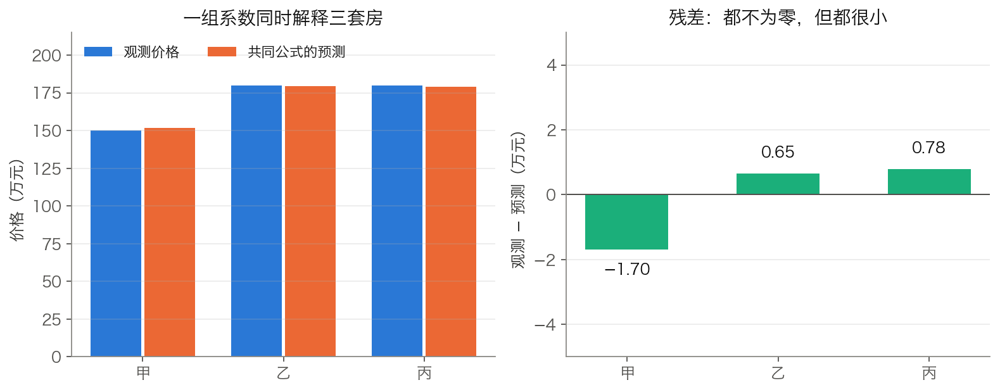

## 前两个观测吻合，第三个却不同

简化仪器模型认为输出是输入乘同一系数 \(c\)。输入1、2、3，观测1、2、2。前两条要求 \(c=1\)，第三条却要求 \(c=2/3\)，不能同时精确解释。

选择 \(c=1\) 留下误差 \((0,0,-1)\)，平方和1。能否不让第三条单独承担全部差别？先说清目标：三条观测同权，要求平方误差和最小。

把输入排成 \(\mathbf a=(1,2,3)^T\)，观测 \(\mathbf b=(1,2,2)^T\)。任意系数给模型输出 \(c\mathbf a\)，这些输出就是一条直线。因此上一章已经解决了几何部分：把 \(\mathbf b\) 投到这条直线上。

\[
\hat c=\frac{\mathbf a^T\mathbf b}{\mathbf a^T\mathbf a}=\frac{1+4+6}{1+4+9}=\frac{11}{14}.
\]

预测是 \(\hat c\,\mathbf a=(11,22,33)/14\)，残差（观测减预测）是 \((14-11,\ 28-22,\ 28-33)/14=(3,6,-5)/14\)，平方和 \((9+36+25)/196=5/14\)，比 \(c=1\) 时的 1 小。三个残差不必各自零，但 \(\mathbf a^T\mathbf r=(3+12-15)/14=0\)。选择的不是一条“正确观测”，而是三条共同参与的最佳解释。

这种最小化 \(\|A\mathbf x-\mathbf b\|^2\) 的选择叫**最小二乘**，“二乘”就是平方：要求残差的平方和最小。残差采用观测减预测 \(\mathbf r=\mathbf b-A\mathbf x\)。

## 多个系数，最近输出如何变成方程？

模型 \(A\mathbf x=x_1\mathbf a_1+x_2\mathbf a_2\) 的全部输出在列空间。最佳残差应与两列都正交，所以

\[
\mathbf a_1^T(\mathbf b-\hat x_1\mathbf a_1-\hat x_2\mathbf a_2)=0,
\qquad \mathbf a_2^T(\mathbf b-\hat x_1\mathbf a_1-\hat x_2\mathbf a_2)=0.
\]

移项得

\[
\begin{bmatrix}\mathbf a_1^T\mathbf a_1&\mathbf a_1^T\mathbf a_2\\\mathbf a_2^T\mathbf a_1&\mathbf a_2^T\mathbf a_2\end{bmatrix}
\begin{bmatrix}\hat x_1\\\hat x_2\end{bmatrix}
=\begin{bmatrix}\mathbf a_1^T\mathbf b\\\mathbf a_2^T\mathbf b\end{bmatrix}.
\]

系数表记录列与列的内积，就是 \(A^TA\)。不是因为旧方程无解就随手乘一个转置，而是先要求残差垂直所有可调方向，才得到**正规方程**

\[
A^TA\hat{\mathbf x}=A^T\mathbf b.
\]

它足以保证最优：换任意输入，输出变化仍在列空间，残差正交，勾股关系使误差只能增加。

## 三套房一起参与，不再保住前两条

第三章两套房给 \((\alpha,\beta)=(2,-10)\)，对90平方米、0.5公里的新房预测175万元。本章给它一个新的假设观测180万元：

| 房屋 | 面积（平方米） | 距离（公里） | 观测（万元） |
| --- | --- | --- | --- |
| 甲 | 80 | 1 | 150 |
| 乙 | 100 | 2 | 180 |
| 丙 | 90 | 0.5 | 180 |

前两条既已唯一确定系数，第三条不同说明没有共同解。要最小化三套房的平方残差，就不应事先要求前两条继续精确。

\[
A=\begin{bmatrix}80&1\\100&2\\90&1/2\end{bmatrix},\qquad
\mathbf b=(150,180,180)^T.
\]

列是面积与距离在三套房上的记录，组合成三维价格空间的平面。对它做投影，再回到系数。需要的都是内积。面积列自己的平方和：\(80^2+100^2+90^2=24500\)；距离列：\(1+4+0.25=21/4\)；两列之间：\(80\cdot1+100\cdot2+90\cdot0.5=325\)。再和观测做内积：面积列得 \(46200\)，距离列得 \(600\)。代入正规方程：

\[
\begin{bmatrix}24500&325\\325&21/4\end{bmatrix}
\begin{bmatrix}\hat\alpha\\\hat\beta\end{bmatrix}
=\begin{bmatrix}46200\\600\end{bmatrix}.
\]

解这两条方程，得到 \(\hat\alpha\approx2.07\)、\(\hat\beta\approx-13.70\)。三套房的预测约为 151.7、179.3、179.2 万元，残差（观测减预测）约为 \(-1.70\)、\(0.65\)、\(0.78\) 万元。

先读结果。第一套略高估，后两套略低估：三条观测都没被精确满足。前两套房原来精确成立的系数 \((2,-10)\) 被放弃了，因为它把全部误差都压给了第三套。

再读残差为什么就停在这里。近似值四舍五入过，直接拿来核对会有误差；残差的精确值是 \((-39,15,18)^T/23\)，乘 23 以后都是整数。用面积列核对：\(80(-39)+100(15)+90(18)=0\)；用距离列核对：\(-39+2(15)+0.5(18)=0\)。残差与两列都正交，所以沿哪一列调整系数，误差都不会再变小。

> [!DETAILS] 手算核对：精确分数
> 系数矩阵的行列式为 \(24500\cdot21/4-325^2=23000\)。用二维消元得到
> \[
> \hat\alpha=\frac{46200\cdot21/4-325\cdot600}{23000}=\frac{951}{460},\qquad
> \hat\beta=\frac{24500\cdot600-325\cdot46200}{23000}=-\frac{315}{23}.
> \]
> 代回得到残差 \((-39,15,18)^T/23\)，正文的近似值都由这些分数四舍五入而来。

图中蓝柱为观测、橙柱为预测，价格单位万元。数据是教学假设，不是现实估值结论。

## 预测唯一，系数为什么未必唯一？

若各列独立，任何非零的 \(\mathbf z\) 都使 \(A\mathbf z\ne0\)。于是 \(\mathbf z^TA^TA\mathbf z=\|A\mathbf z\|^2>0\)，所以 \(A^TA\mathbf z\) 不可能为零：\(A^TA\) 没有非零的零空间向量，可逆，最佳系数唯一。

但 \(H=\begin{bmatrix}1&1\\2&2\end{bmatrix}\) 只读取 \(c=x_1+x_2\)。它的输出都在 \((1,2)\) 这条直线上。把观测 \((1,1)\) 投到这条线上：\(c=(1+2)/(1+4)=3/5\)，唯一最佳预测 \((3/5,6/5)\)；系数却只需满足 \(x_1+x_2=3/5\)，有无穷多份。

这些输入差在 \(N(H)\) 中，不能给奇异的 \(H^TH\) 求普通逆。第二十二章会在等效系数中选一份最短的，但“最短”还得说明输入尺度。

最小二乘并不证明模型合理，也不赋予系数因果含义。如果认为价格里还有一份与面积、距离都无关的固定部分，可以在 \(A\) 里再加一列全是 1 的列，让它的系数代表这份固定价格；观测可靠程度不同，可以给平方误差加权。这些都是重新说明模型和任务，不是同一个模型的计算技巧。

[拟合实验](https://colab.research.google.com/github/xiaoheng008/linear-algebra-evolution/blob/main/experiments/20_least_squares.ipynb)比较旧系数与共同拟合，检查平方误差和正交残差。实际数值计算一般用 QR 或 SVD，不显式求逆，通常也避免直接形成 \(A^TA\)：两列接近重复时，计算对舍入误差本来就敏感，形成 \(A^TA\) 会把这种敏感程度放大成原来的平方。下一章从正交方向解释另一条求法。
