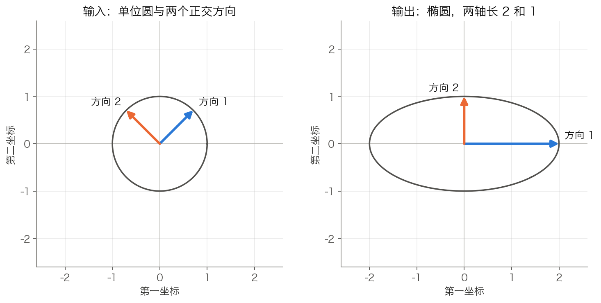

## 不必要求输入和输出沿同一个方向

剪切不能找到完整特征基，不能对角化。长方形矩阵的输入输出连坐标数都不同，更谈不上让同一个向量只乘一个数。

但我们的实际愿望是把计算拆开。也许不需要输入输出使用**同一组**方向，只需要每个输入分别送到一个好分辨的输出。先从这个矩阵的两个输出式找起：

\[
A=\frac1{\sqrt2}\begin{bmatrix}2&2\\-1&1\end{bmatrix}.
\]

对任意输入，两个输出分别为

\[
A\begin{bmatrix}x_1\\x_2\end{bmatrix}
=\begin{bmatrix}\sqrt2(x_1+x_2)\\(-x_1+x_2)/\sqrt2\end{bmatrix}.
\]

第一输出看和，第二输出看差。若两项相等，第二输出消失；若两项相反，第一输出消失。于是等值、反值输入各自只控制一项输出，这就是值得尝试它们的原因。

## 同样长的输入，输出各有多长？

取 \((1,1)\)，输出 \((2\sqrt{2},0)\)；取 \((-1,1)\)，输出 \((0,\sqrt{2})\)。输入都长 \(\sqrt2\)，不能把输出长直接当缩放倍数。

先把两个除以输入长度，得到单位输入

\[
v_1=(1,1)^T/\sqrt2,\qquad v_2=(-1,1)^T/\sqrt2.
\]

它们互相正交。现在计算

\[
Av_1=(2,0)^T=2u_1,\qquad Av_2=(0,1)^T=u_2,
\]

输出单位方向 \(u_1=(1,0)^T,u_2=(0,1)^T\) 也正交。等长输入分别伸长2倍、1倍，但输出方向与输入不同。

蓝、橙跟踪同一个输入及它的输出。它们不是特征向量，因为输出不沿原输入直线；分开记录两边，反而让作用更简单。

## 把刚才的计算排成三步

单位正交输入基排为 \(V=[v_1\ v_2]\)，输出基排为 \(U=[u_1\ u_2]=I\)，倍数排为 \(\Sigma=\operatorname{diag}(2,1)\)。

任意输入先取坐标 \(c=V^Tx\)，每项各乘倍数，再按输出方向合成：

\[
x\xrightarrow{V^T}c\xrightarrow{\Sigma}\Sigma c\xrightarrow{U}Ax,
\qquad A=U\Sigma V^T.
\]

例如 \(x=(\sqrt2,0)^T\)，第一步 \((1,-1)\)，第二步 \((2,-1)\)，合回仍 \((2,-1)\)，直接乘原矩阵也一样。

这叫**奇异值分解**，简称 SVD。非负缩放倍数叫**奇异值**，通常按从大到小排列。

## 看不出和差时，怎样系统找方向？

我们的目标是不同输入基的**输出正交**。输出内积可以移回输入一侧：

\[
(Av_i)^T(Av_j)=v_i^TA^TAv_j.
\]

于是 \(A^TA\) 出现有明确目的：它在输入空间记录输出之间的内积。

我们希望不同方向的这个内积为零。怎样才能做到？如果 \(v_j\) 恰好是 \(A^TA\) 的特征向量，\(A^TAv_j=\lambda_jv_j\)，右边就变成

\[
v_i^TA^TAv_j=\lambda_j\,v_i^Tv_j.
\]

所以只要输入方向彼此正交，而且都是 \(A^TA\) 的特征向量，不同方向的输出就自动正交。寻找“输出正交”的输入，就转成了寻找 \(A^TA\) 的正交特征基。\(A^TA\) 是对称矩阵（\((A^TA)^T=A^TA\)），第十八章的谱定理保证这样的基存在。

对本例，原列内积组成

\[
A^TA=\frac12\begin{bmatrix}5&3\\3&5\end{bmatrix}.
\]

等值、反值方向分别对应特征值4、1，归一化正是之前找到的 \(v_1,v_2\)。单位输入满足 \(\|Av_i\|^2=v_i^TA^TAv_i\)，所以4、1是输出**平方长度**，奇异值是2、1。再计算输出、除以长度，才得到 \(u_i\)。

这条通用路线不要求矩阵的输出式恰好是和与差，也不要求原矩阵有特征基。

## 三个输入、两个输出，怎样排表？

\[
H=\begin{bmatrix}2&0&0\\0&1&0\end{bmatrix}.
\]

三个标准输入依次到 \((2,0)\)、\((0,1)\)、零。完整输入基有三个，输出基两个，令 \(V=I_3,U=I_2,\Sigma=H\) 就能描述全部作用。第三输入被压掉，属于零空间，不需要给它编造非零输出方向。

一般 \(A:m\times n\) 完整形式为 \(U:m\times m,\Sigma:m\times n,V:n\times n\)。有 \(r\) 个非零奇异值时，只留参与作用的方向可写

\[
A=U_r\Sigma_rV_r^T,
\]

尺寸为 \(m\times r,r\times r,r\times n\)。省略零方向不是说它不存在。值零时不能用 \(Av_i/\sigma_i\) 求单位输出，完整输出基的剩余方向需另行补齐。

## 为什么一般实矩阵确实能这样做？

这段使用实对称矩阵谱定理。它的进阶证明依赖分析，已在第十八章说明；算对几个例子不是一般存在性证明。

谱定理给 \(A^TA\) 完整单位正交特征基 \(v_i\)。相应特征值 \(\lambda_i=\|Av_i\|^2\ge0\)。令 \(\sigma_i=\sqrt{\lambda_i}\)，非零时令 \(u_i=Av_i/\sigma_i\)，则

\[
u_i^Tu_j=\frac{v_i^TA^TAv_j}{\sigma_i\sigma_j}
=\frac{\lambda_jv_i^Tv_j}{\sigma_i\sigma_j}.
\]

不同方向为零，同方向为1。值零时 \(Av_i=0\)。任意输入沿完整 \(v_i\) 展开，便得到 \(Ax=\sum_{i=1}^r\sigma_i(v_i^Tx)u_i\)，所以分解对全部输入成立。输出的正交方向可补成完整基。

\(r\) 个非零输出方向独立、张成列空间，因此 \(r\) 就是秩。对应 \(u_i\) 张成列空间，\(v_i\) 张成行空间；剩余输入、输出方向分别张成零空间、左零空间。四空间在这里成为一条条看得见的作用路线。

数值库不必直接形成 \(A^TA\) 求 SVD；形成它可能损失精度。小奇异值的方向反向恢复要除以小数，测量误差因此容易放大，理论可逆不等于数值容易恢复。

## 多份输入一样好，怎样选最短一份？

先用 \(H\) 与目标 \((6,2)\)：输入只能前两项3、2，第三任意，全部为 \((3,2,t)\)，平方长度 \(13+t^2\)。最短明显是 \((3,2,0)\)，不是因为第三项解不出来，而是它对输出没有贡献。

一般目标在输出基下的坐标 \(d_j=u_j^Tb\)，输入系数记 \(c_i=v_i^Tx\)。正交性把误差拆为

\[
\|Ax-b\|^2=\sum_{i=1}^r(\sigma_ic_i-d_i)^2+\sum_{j=r+1}^m d_j^2.
\]

后半无法到达，前半各项取零需要 \(c_i=d_i/\sigma_i\)。其他输入系数在零空间，不影响误差，取零才使输入最短。因此

\[
\hat x=\sum_{i=1}^r\frac{u_i^Tb}{\sigma_i}v_i=A^+b.
\]

\(A^+\) 叫**伪逆**。它先保留可达输出，再除以各方向缩放，不给不可见方向额外系数。对可逆方阵就是普通逆；对于重复列，预测唯一但系数很多，伪逆选所用欧氏刻度下最短的一份，未必是业务上唯一合理的解释。

[方向发现与 SVD 实验](https://colab.research.google.com/github/xiaoheng008/linear-algebra-evolution/blob/main/experiments/22_svd.ipynb)从和差输出开始，再核对内积表与通用流程。对数值结果比较重建、正交性，不硬比符号；重复奇异值下基还可能旋转。

方向已经拆开。下一章只保留其中一部分，明确比较省了多少记录、损失了多少数值。
