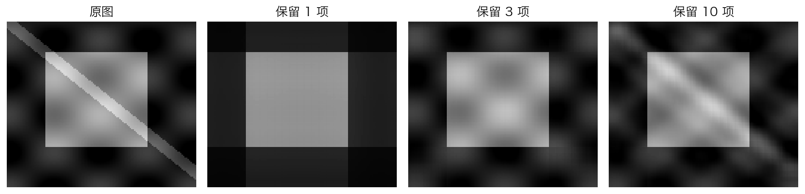

## 两行数据，能否不逐格记录？

数值表

\[
\begin{bmatrix}3&1&-1\\6&2&-2\end{bmatrix}
\]

第二行是第一行两倍。可以记共同曲线 \((3,1,-1)\) 和两行各自系数 \((1,2)\)，用5个数复原6个格子。把它写为

\[
u v^T=\begin{bmatrix}1\\2\end{bmatrix}[3\ 1\ {-1}].
\]

这是**外积**，每列是 \(v_j\) 倍的 \(u\)，非零时秩1。一列乘一行生成矩阵，与一行乘一列得到一个数的内积不同；两边向量也不必同长度。

温度传感器的读数可能近似共享一条时间曲线，但不一定精确。我们可以保留这种共同变化，也要衡量没有记录的差别。

## 只准留一个方向，先比较真正的损失

取 \(A=\operatorname{diag}(4,1)\)。保留左上角那份，近似为 \(\operatorname{diag}(4,0)\)，剩余一个1；保留右下角，剩余一个4。按所有格子平方误差之和，两份损失分别1、16，因此留第一份更好。

这样的误差量叫 **Frobenius 范数**的平方：\(\|E\|_F^2=\sum_{ij}E_{ij}^2\)。相当于把所有格子排成一个向量来量长度。

这里还只比较了两种候选，不能就宣布任何秩1近似都不如第一份。先利用 SVD 算出一般截断误差，再证明它覆盖全部候选。

## SVD 的每一项为什么都是可单独记录的分量？

上一章的方向表达给

\[
A=\sum_{i=1}^r\sigma_i u_i v_i^T.
\]

每项是一份秩1外积：输入沿 \(v_i\) 的系数被放大 \(\sigma_i\) 后送到 \(u_i\)。只留前 \(k\) 项叫**截断 SVD**，得到 \(A_k\)，秩不超过 \(k\)。

矩阵内积为 \(\langle B,C\rangle_F=\sum_{ab}B_{ab}C_{ab}\)。展开两项外积，求和分开得

\[
\langle u_iv_i^T,u_jv_j^T\rangle_F=(u_i^Tu_j)(v_i^Tv_j).
\]

不同项正交，相同项平方长度1。所以丢掉的各项没有交叉误差：

\[
\|A-A_k\|_F^2=\sum_{i>k}\sigma_i^2.
\]

对 \(\operatorname{diag}(4,1)\)，保留一项留下 \(16/17\) 平方总量，损失1。这里的总量是指定数值刻度，不自动对应相同比例的业务价值。

## 有没有更巧的秩 k 近似？

任何秩不超过 \(k\) 的候选 \(B\)，列都在至多 \(k\) 维子空间。令 \(P\) 投到那个空间，因为 \((I-P)B=0\)，至少要承担 \(A\) 在空间之外的损失：

\[
\|A-B\|_F^2\ge\|(I-P)A\|_F^2
=\|A\|_F^2-\|PA\|_F^2.
\]

候选无论怎样选系数，都不能让其列空间以外的那份消失。剩下的问题是：一个 \(k\) 维空间最多保留多少？

先在 \(\operatorname{diag}(4,1)\) 上试 \(k=1\)。秩 1 的候选，列都落在某条直线上；设这条直线的单位方向是 \(q=(a,b)^T\)，\(a^2+b^2=1\)。把 \(A\) 的两列投到这条线上，保留的平方总量是

\[
\|PA\|_F^2=(4a)^2+b^2=16a^2+b^2=1+15a^2\le16.
\]

一个方向可以从两份变化里各保留一部分，却不能把两份都完整留下：\(a\) 和 \(b\) 的平方加起来只有 1，分给大的那份才最划算。取 \(q=(1,0)^T\) 时保留 16，损失 \(17-16=1\)，正是截断 SVD 的误差。任何别的方向都损失更多。

一般情形是同一个想法：每个奇异分量只能被保留一定比例，所有比例加起来受维数限制，所以最好把比例全部分给最大的几项。

> [!DETAILS] 一般情形的证明
> 用 SVD 和右方向正交性，\(\|PA\|_F^2=\sum_i\sigma_i^2\|Pu_i\|^2\)。每个权重介于0与1，总和不超过 \(k\)：若投影空间的单位正交基为 \(q_1,\ldots,q_d\)，则
> \[
> \sum_i\|Pu_i\|^2=\sum_{j=1}^d\sum_i(q_j^Tu_i)^2\le d\le k.
> \]
> 内层只是一个单位向量在若干正交方向的坐标平方和，不超过1。
>
> 奇异值降序排列，把较小项的权重移到尚未填满的较大项不会减小保留量。因此上界为 \(\sum_{i\le k}\sigma_i^2\)，任何候选的损失至少是尾部平方和。\(A_k\) 恰好达到这一下界，所以是全部秩不超过 \(k\) 矩阵中的最佳 Frobenius 近似。

截断位置有重复奇异值时，最佳近似可以不唯一，但最佳误差不变。这里讨论的是这一种误差准则，不是对任何损失都同样最优。

## 用到图片时，误差和存储分开检查

灰度亮度组成矩阵，可以比较保留1、3、10项。下面使用一张人工构造的灰度图。

重建亮度可能超出显示范围，显示时裁切；误差在显示裁切前计算，才能与尾部平方和比较。看着清楚多少，和数值误差多少，是两个不同检查。

存 \(U_k\)、奇异值、\(V_k\) 约需 \(k(m+n+1)\) 个数，原表需 \(mn\)。只有前者小才节省这类存储；低秩不自动意味压缩，也不是现代图像编码的全部过程。

[低秩实验](https://colab.research.google.com/github/xiaoheng008/linear-algebra-evolution/blob/main/experiments/23_low_rank.ipynb)把实际误差与尾部平方和并列，并检查存储门槛。下一章把“近似一张表”具体化为“每位对象只留少数特征坐标”。
