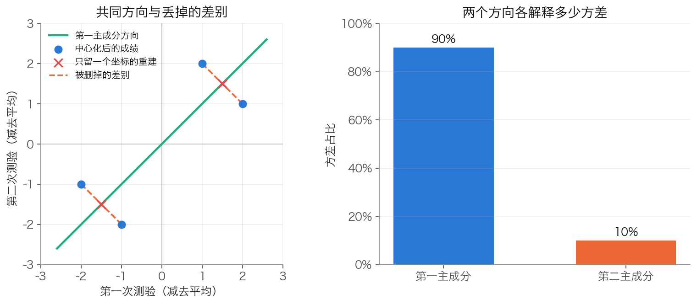

## 每人只能记一个数，应该记什么？

四位学生两次百分制成绩为 \((72,71)\)、\((71,72)\)、\((69,68)\)、\((68,69)\)。只留第一次成绩，第二次之间的差别丢了；两次似乎常一起高、一起低，能否用一个数记录这种共同变化？

先决定研究什么。如果想比较学生之间的差异，大家都接近70分这件共同事实不该占用主要方向。分别求两列平均，都是70，减去平均向量：

\[
X=\begin{bmatrix}2&1\\1&2\\-1&-2\\-2&-1\end{bmatrix}.
\]

这叫**中心化**。平均向量另外保留，恢复时会加回；不是把平均成绩永远丢掉。

## 比较三个只能留一个数的方案

中心化表的平方总量20。

只留第一列偏差，坐标 \((2,1,-1,-2)\)，保留量10；第二列重建为零，损失10。

两列同增、同减，是从数据本身可见的主要模式。因此试单位共同方向 \(v=(1,1)^T/\sqrt2\)。

先慢慢算第一位学生。中心化行是 \((2,1)\)，它沿 \(v\) 的坐标是内积 \((2+1)/\sqrt2=3/\sqrt2\)。只记这一个数，投回两列得 \((3/\sqrt2)v=(1.5,1.5)\)。原来是 \((2,1)\)，差 \((0.5,-0.5)\)，损失 \(0.25+0.25=0.5\)。

其余三位同样计算，坐标依次为 \(3/\sqrt2,-3/\sqrt2,-3/\sqrt2\)，重建为 \((1.5,1.5)\)、\((-1.5,-1.5)\)、\((-1.5,-1.5)\)，每人也损失 0.5。四个坐标的平方和为 18，损失合计 2。

反过来只留差别方向 \((1,-1)/\sqrt{2}\)，保留2、损失18。三个方案都只有一个坐标，却分别保留10、18、2。按勾股分解，完整量等于保留量加损失，所以保留最多和重建损失最少是同一目标。

但共同方向是否比所有其他角度都好，不能只凭三种比较决定。

## 写出所有方向都适用的目标

单位方向 \(v\)，每个中心化行 \(x^T\) 的坐标是 \(x^Tv\)，合起来为 \(Xv\)。保留量为

\[
\|Xv\|^2=v^TX^TXv,\qquad \|v\|=1.
\]

必须固定单位长度，否则同一方向乘10，坐标平方就乘100，比较的只是刻度。中心化后新坐标均值为零，平方和除以样本数减 1，就是**样本方差**，衡量数据围绕平均值散开的程度；它的平方根叫**标准差**。本例除数是 3，除以同一个数不改变哪个方向最大。

本例逐列算出

\[
X^TX=\begin{bmatrix}10&8\\8&10\end{bmatrix}.
\]

等值、反值方向对应特征值18、2。任意单位方向写成 \(v=c_1v_1+c_2v_2\)，\(c_1^2+c_2^2=1\)，保留量为 \(18c_1^2+2c_2^2\le18\)，共同方向恰好取到18。这才排除了所有其他角度。

一般实对称矩阵由谱定理提供单位正交特征基。同样展开得 \(\sum_i\lambda_i c_i^2\le\lambda_1\)，所以最大的特征方向保留最多。最大值重复时方向不唯一。

## 这就是主成分方向，但不是每个人的新坐标

先给刚才的做法起名字。找到的共同方向 \(\mathbf v_1=(1,1)^T/\sqrt2\) 叫第一**主成分方向**。它是特征空间里的一个方向，全班只有一个。每位学生沿这个方向的坐标，\(3/\sqrt2,3/\sqrt2,-3/\sqrt2,-3/\sqrt2\)，才是各人的新坐标，四个人四个数。

方向和坐标是两样东西：方向说“从哪个角度看”，坐标说“每个人在这个角度上是多少”。

把四个坐标排成一列，就是 \(\mathbf z=X\mathbf v_1\)。用它乘回方向，\(\mathbf z\mathbf v_1^T\) 就是只留这个方向时的重建，正是前面算出的 \((1.5,1.5)\) 等四行。再加回平均值 70，就回到原来的成绩刻度。

留更多方向时做法相同。对中心化表做 SVD \(X=U\Sigma V^T\)，\(V\) 的前 \(k\) 列就是前 \(k\) 个主成分方向。新坐标与重建是

\[
Z=XV_k=U_k\Sigma_k,\qquad X_k=ZV_k^T.
\]

\(Z\) 是“对象数×\(k\)”的坐标表，\(V_k\) 是“特征数×\(k\)”的方向表。这种选择叫**主成分分析**，简称 PCA。

为什么前 \(k\) 个方向最好？只留任意 \(k\) 个方向的投影重建，都是秩不超过 \(k\) 的矩阵。上一章证明了，在所有这样的矩阵里，截断 SVD 的误差最小；而选前 \(k\) 个右奇异方向，得到的恰好就是截断 SVD。

本例只留共同方向，加回70后前两人成 \((71.5,71.5)\)、后两人成 \((68.5,68.5)\)。我们还知道共同高低，却不能再分辨前两人哪次更高。完整换基可恢复，删掉一项才造成损失。

特征值18、2是奇异值的**平方**，不是奇异值本身。保留比例 \(18/(18+2)=90\%\)，平方误差2；不意味着保留了90%的知识或预测能力。

## 中心化与标准化不是同一件事

中心化减去共同位置，标准化还按列尺度改变距离。如果把一项从分改成另一种更大的数值单位，即使表达同一事实，也可能改变主成分。是否除以各列标准差，由任务决定，不是固定必做步骤；常数列标准差零，不能直接相除。

本例两次成绩同刻度，未额外标准化。[PCA 实验](https://colab.research.google.com/github/xiaoheng008/linear-algebra-evolution/blob/main/experiments/24_pca.ipynb)另外使用 \((10,\pm 2)\)、\((12,\pm 2)\)：减去均值 \((11,0)\) 后，第一、第二方向平方量4、16，主要差别在第二项；直接用原表则为488、16，位置偏向第一项。这个对照能实际说明为什么先问“研究位置还是差异”。

下一章不给新术语，从完整问题重新选择这些工具，检查自己能否把路线走回来。
